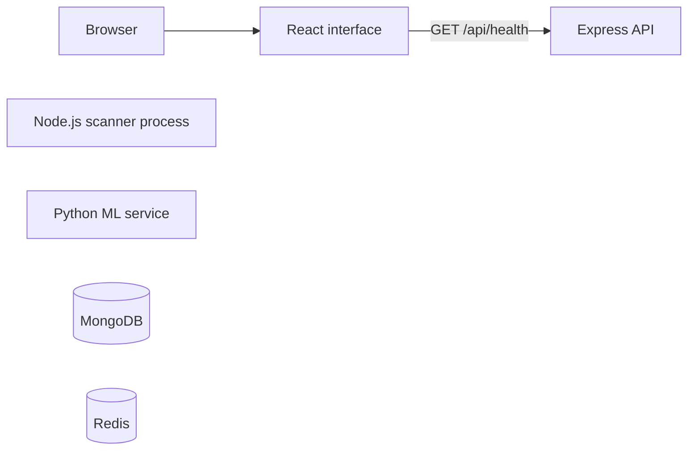

# Service architecture

## Running application

The browser loads the React page and requests health information from its own origin. Vite forwards the request in development. The production web image serves the static build with nginx and proxies the same path. The scanner and ML service expose separate health endpoints. Compose starts MongoDB and Redis and checks each with its native client.

| Component | Default host port | Exposure |
| --- | --- | --- |
| Web | 5173 | Loopback |
| API | 3001 | Loopback |
| Scanner | 3002 | Loopback |
| ML | 8000 | Loopback |
| MongoDB and Redis | Internal only | Compose network |

The Compose application containers run as non-root users with read-only root filesystems and temporary storage where needed. Separate named volumes hold database and queue data. Set application host ports in `.env`. The source launcher starts four local processes and stops them together. See the [operating instructions](../README.md).

## Health semantics

`status: "ok"` means a process accepts a health request. Each backend reports bootstrap mode and its capability flags. The API reports scanning and persistence as disabled. The scanner reports queue consumption as disabled. The ML service reports inference as disabled and `modelLoaded: false`. Readiness for business operations belongs to the implementation of those operations.

## Planned scan flow

Express will authorize a target, persist an accepted request in MongoDB and dispatch through BullMQ on Redis. The scanner will consume jobs, collect TLS, HTTP, DNS and provider evidence, evaluate the rule policy and store results. Versioned ML predictions will supplement those results. The API will serve progress, evidence and feedback to React. See the [specification](specification.md) and [implementation plan](implementation-plan.md).
