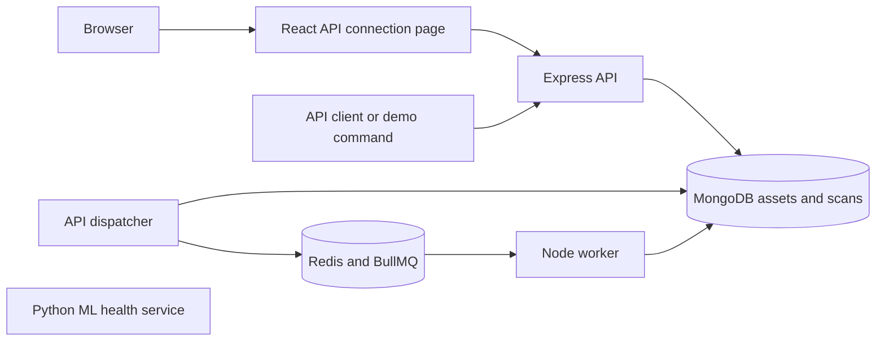

# Service architecture

## Current request flow

The web interface requests API health through its own origin. Vite proxies in development and nginx serves the built interface in Compose. Current asset and scan operations are available through the API and demo command. The dashboard is a later stage.

API and worker support collection and orchestration_test modes when storage is enabled. A bootstrap source mode supports interface development. MongoDB records accepted requests before acknowledgement. The collection worker commits TLS/HTTP observations and source summaries together. External DNS and SSL Labs remain unavailable, so the scan is partial. Orchestration-test requests retain their explicit unmeasured result.

## Recovery and service boundaries

An exact server allowlist governs target submission and worker execution. MongoDB uniqueness indexes protect hostname and request identity. A dispatch timestamp in each incomplete scan allows API processes to reconcile failed queue publication. BullMQ uses the scan UUID as a job ID, manages worker locks and recovers stalled jobs. A conditional MongoDB update commits the terminal state once. [Recovery decision](decisions/0002-durable-orchestration.md).

Health describes process liveness and implemented capabilities. /ready probes MongoDB and Redis and returns 503 when a dependency is unavailable. Requests can be accepted durably into MongoDB while Redis is offline. Collection enforces destination, time and size limits. External assessments and predictions have later acceptance gates.

## Ports and deployment

| Component | Default host port | Exposure |
| --- | --- | --- |
| Web | 5173 | Loopback |
| API | 3001 | Loopback |
| Scanner | 3002 | Loopback |
| ML | 8000 | Loopback |
| MongoDB and Redis | Internal only in Compose | Development override exposes loopback 27017 and 6379 |

Application containers run as non-root users with read-only root filesystems and temporary storage where needed. Named volumes retain database and queue data. Redis uses AOF and noeviction. Source development uses the storage-only Compose override and four local processes. [Operating instructions](../README.md).

## Contracts and lab

JSON Schema and OpenAPI share definitions used by JavaScript and Python tests. The TLS lab generates fresh relative-date certificates and loopback HTTPS/HTTP/TCP listeners. Weak RSA and SHA-1 fixtures are inspected offline. Provider failures are labeled synthetic. [Contracts](../packages/contracts/README.md) and [lab guide](../tests/fixtures/tls/README.md).

## Evidence and planned analysis

The worker now collects TLS and HTTP evidence. It will add external DNS and provider observations, evaluate rules and persist findings. A versioned Python model will supplement these findings. React will gain target management, progress, evidence and feedback. [Implementation plan](implementation-plan.md).
