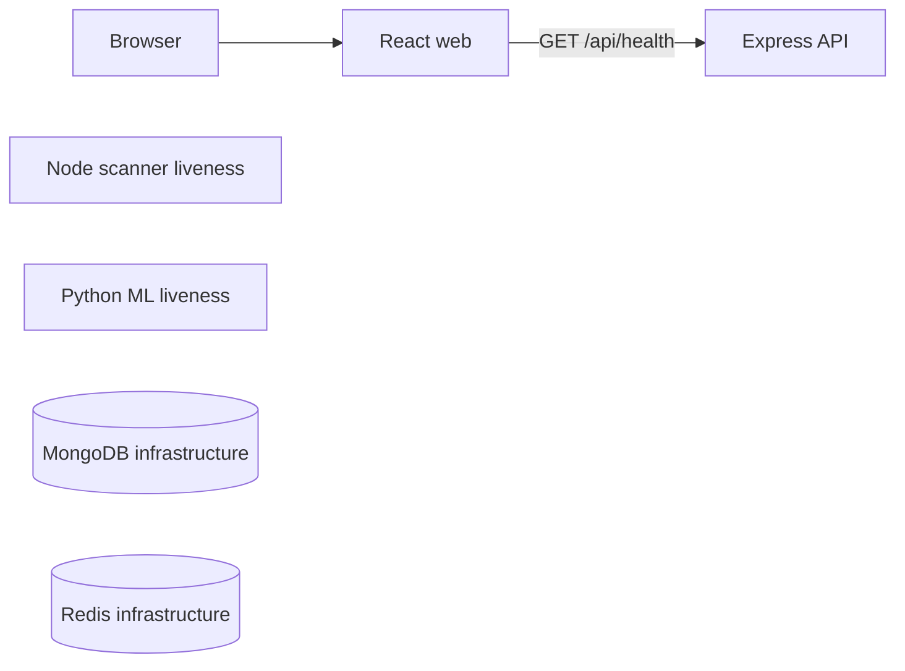

# ארכיטקטורת המערכת

שלב 1 מקים תהליכים נפרדים ודרך הרצה משותפת. היכולות העסקיות עדיין אינן ממומשות.

## זרימה פעילה בשלב 1

הדפדפן פונה לאותו origin של web. Vite בהרצה המקומית ו־nginx בקונטיינר מעבירים בקשות /api לשרת Express. אין צורך ב־CORS פתוח או בכתובת backend שנצרבת בקוד הדפדפן.

scanner ו־ML הם תהליכים עצמאיים עם health. MongoDB ו־Redis קיימים ב־Compose ומבצעים בדיקות health משלהם, אך עדיין אינם משמשים לשמירת סריקות או לתור.

## פורטים

| רכיב | פורט ברירת מחדל במחשב | חשיפה |
| --- | --- | --- |
| web | 5173 | loopback בלבד |
| api | 3001 | loopback בלבד |
| scanner | 3002 | loopback בלבד |
| ml | 8000 | loopback בלבד |
| MongoDB | אין | רשת Compose בלבד |
| Redis | אין | רשת Compose בלבד |

אפשר לשנות את ארבעת הפורטים דרך .env. בתוך קונטיינרים פורטי היישום קבועים; Compose ממפה אותם לפורטים המקומיים שנבחרו. npm run dev מפעיל ארבעה תהליכים ישירים ומסיים אותם יחד ביציאה.

## גבולות health

status=ok פירושו שהתהליך מקבל בקשות. capabilities מכיל false עבור יכולות עתידיות. היעדר מודל אינו תקלה בשלב 1, ולכן ML חי אך modelLoaded=false. החל משלב 3 נגדיר readiness של התלויות והפעולות העסקיות בנפרד מ־liveness.

## הרצה ונתונים

הקונטיינרים של היישום רצים כמשתמש שאינו root. מערכות הקבצים שלהם מוגדרות לקריאה בלבד; nginx משתמש ב־tmpfs לנתונים זמניים. MongoDB ו־Redis משתמשים ב־volumes עמידים.

הרצה מקומית ללא Docker מספיקה לשלב 1 כי אין עדיין תלות עסקית במסד או בתור. בשלבים הבאים הרצה מלאה תצריך תשתיות אלה. אין להסיק מתנאי ההרצה הנוכחיים שכבר נבדקה התמדה עסקית.

## ארכיטקטורת היעד

בהמשך API ישמור בקשות ויפרסם לתור, scanner יאסוף ראיות ויחשב ממצאים, ושירות Python יחזיר ציון ממודל מתועד. תרשים היעד וגבולות האחריות המלאים נמצאים ב־[תוכנית הביצוע](implementation-plan.md).
