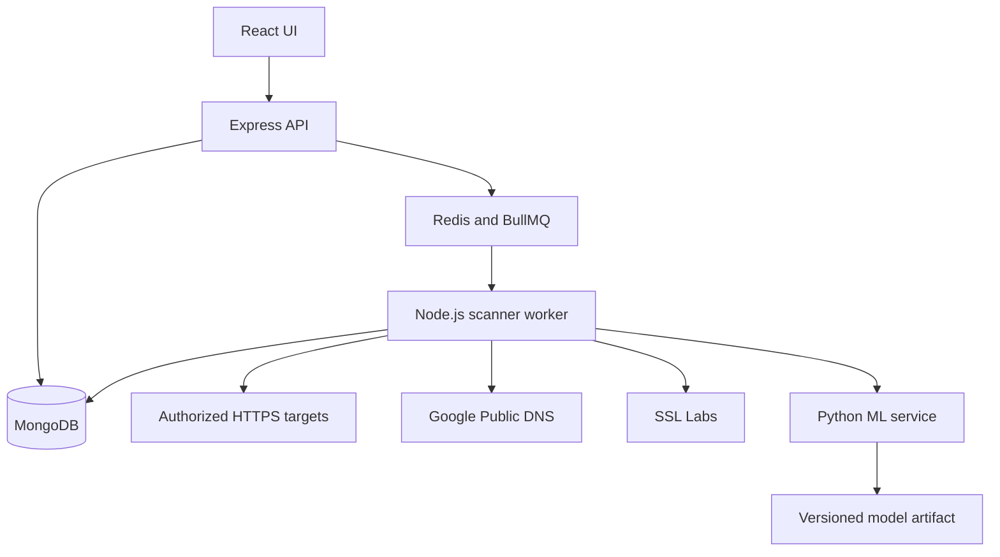

# AI security agent

הצעת פרויקט ותוכנית ביצוע עבור סוכן הפיתוח. המערכת תאסוף ותנתח סיכוני אבטחה באתרי HTTPS, תעריך חולשות בתעודות ובתצורת TLS, ותבחן שימוש בלמידת מכונה לצמצום התרעות שווא.

המאגר: [liorma6/AI-security-agent-](https://github.com/liorma6/AI-security-agent-).

מועד התכנון: 4 בנובמבר 2026. שלב 0 הושלם; שלב 1 מומש ונמצא באימות. השלב הבא לאחר השלמתו הוא שלב 2. התוכנית מחולקת לתוצרים ניתנים לבדיקה ולקומיטים, ללא הנחות על צוות או לוח זמנים. המצב המפורט והיסטוריית השלבים נשמרים ב־[מסמך האפיון](specification.md) וב־[יומן השלבים](stage-log.md).

## הצעת הפרויקט

מפתח או אחראי אתר מוסיף דומיין שבאחריותו ומפעיל בדיקה. סוכן שנכתב ב־Node.js אוסף נתוני DNS, תעודות TLS ותגובות HTTP, משלב מידע מספקים חיצוניים ומייצר ממצאים מוסברים. ממשק React מציג חומרה, ראיות, מקור הבדיקה, זמן המדידה והמלצת תיקון. שירות Python לומד מדוגמאות מתויגות ומעריך אילו ממצאים מועמדים לבדיקה חוזרת כהתרעות שווא.

תרחיש ההדגמה המרכזי: אתר מעבדה עם תעודה שפג תוקפה מופיע עם ממצא וראיות; לאחר החלפת התעודה ובדיקה חוזרת, הממצא מסומן כנפתר. בדוגמה נפרדת, ממצא שגוי עקב שיוך נתונים לא נכון מסומן כהתרעת שווא, והמערכת שומרת את ההסבר ואת החלטת הבודק.

המסגרת הטכנולוגית והיכולות העיקריות מוכתבות בדרישות. הבחירה שנותרה היא אילו בדיקות לממש, כיצד לחלק את השירותים, ומה תפקיד המודל והדרך למדוד אותו. המיקוד שנבחר בשיחה הוא אתר ותעודות TLS. ניתוח קוד או קובצי הגדרות של יישומי Node.js אינו חלק מגרסת הבסיס; הניסוח המקורי על modules לא הובהר על ידי המנחה. אם תגיע דרישה מפורשת כזאת, נעדכן את ההיקף לפני הוספתה.

הביטוי המקורי “download False Positives” מפורש כאן כהפחתת התרעות שווא. SSL הוא המונח שבדרישות; המימוש והמסכים יתייחסו ל־TLS המודרני.

## התאמה לדרישות

| דרישה | מימוש מוצע | הוכחת השלמה |
| --- | --- | --- |
| Node.js ו־Express | API ושירות סריקה מודולרי | בקשה מפעילה סריקה ונשמרות תוצאות |
| React.js | ניהול יעדים, מצב סריקה, ממצאים ומשוב | תרחיש משתמש מלא בדפדפן |
| Microservices | API, Worker ושירות ML בתהליכים וקונטיינרים נפרדים | הפעלה עצמאית וחוזים מתועדים |
| ממשקים חיצוניים | Google Public DNS ו־SSL Labs | בדיקות חיבור אמיתיות לצד בדיקות מבוקרות |
| הערכת חולשות SSL | איסוף TLS, אימות תעודה וכללי סיכון | בדיקות מול שרתי מעבדה עם אמת ידועה |
| AI ו־ML ב־Python | אימון, השוואת מודלים ושירות חיזוי | ניסוי ניתן לשחזור על קבוצת בדיקה נפרדת |
| הפחתת False Positives | אימות חוזר, משוב ומסנן נבחן | Precision, Recall וניתוח טעויות |
| עומסים גבוהים | תור עבודות, הגבלת קצב וריבוי Workers | דוח עומס בתנאים מפורטים |
| MongoDB | יעדים, סריקות, תצפיות, ממצאים ומשוב | התמדה לאחר הפעלה מחדש |
| Docker ו־GitHub | Compose, בדיקות אוטומטיות וקומיטים לפי שלבים | התקנה נקייה והיסטוריית עבודה |
| תוצרי הגשה | אפיון, קוד, סרטון, פוסטר ומצגת | רשימת מסירה עם קישורים וקבצים אמיתיים |

## גבולות גרסת הבסיס

המערכת תקבל hostname, או כתובת HTTP/HTTPS שממנה יופק hostname. הבדיקות יוגבלו לדף השורש ולפורטים 80 ו־443. לא יישלחו פרטי הזדהות של האתר, ולא יבוצעו זחילה, ניצול חולשות או שינוי באתר.

היכולות הכלולות:

- ניהול רשימת יעדים מאושרים והפעלת סריקה ידנית, בודדת או בקבוצה מוגבלת.
- בדיקת תוקף תעודה, התאמת שם המארח, שרשרת אמון, ומאפייני מפתח וחתימה לפי מדיניות מתועדת.
- בדיקת HTTPS, הפניה מ־HTTP ל־HTTPS ו־HSTS כוולידציות אתר בסיסיות.
- נתוני פרוטוקולים והצפנות משירות חיצוני, כאשר זמינים, עם מקור וזמן המדידה.
- היסטוריית סריקות, השוואת ממצאים, ראיות, המלצות תיקון וייצוא JSON/CSV.
- תיוג ממצאים, אימון מודל והשוואת תוצאות לפני ואחרי סינון.
- מצב הדגמה מקומי שחוזר על אותן בדיקות ללא תלות בספק חיצוני.

לא נכללים בגרסת הבסיס: סריקת חבילות npm, ניתוח קוד סטטי, תיקון אוטומטי, צ'אט עם LLM, Kubernetes, מערכת SaaS למספר ארגונים או סריקה מחזורית. אלה הרחבות אפשריות בלבד.

המונח agent מתאר את תהליך האיסוף והניתוח האוטומטי. אין בדרישות חובה להשתמש במודל שפה.

## הבדיקות והתנהגות התוצאות

| משפחת בדיקה | ראיה נדרשת | כלל פרשנות |
| --- | --- | --- |
| תעודה שפג תוקפה או שטרם נכנסה לתוקף | תאריכים, זמן בדיקה, fingerprint | ממצא עובדתי עם זמן מדידה |
| תעודה שעומדת לפוג | מספר ימים שנותרו | התרעת תחזוקה; הסף ניתן להגדרה |
| אי התאמה לשם המארח | hostname, SNI ושמות SAN | אימות שם מפורש עבור היעד שנבדק |
| שרשרת אמון לא תקינה | שרשרת, trust store ושגיאת אימות | תיעוד סביבת האמון; CA פרטי מאושר אינו פסילה אוטומטית |
| מפתח או חתימה חלשים | סוג, גודל ואלגוריתם | מדיניות עם גרסה ומקור טכני עדכני |
| פרוטוקול או הצפנה מיושנים | בדיקה ייעודית או תשובת ספק | פרוטוקול יחיד שנבחר בחיבור אינו רשימת כל הפרוטוקולים הנתמכים |
| HTTP ללא הפניה ל־HTTPS | תגובת HTTP ויעד הפניה | להבדיל מהיעדר שירות בפורט 80 |
| HSTS חסר או לא תקין | כותרת מתגובת HTTPS תקינה | המלצת הקשחה לפי ההקשר; לא מסקנה שהאתר נפרץ |
| שגיאת DNS או timeout | קוד שגיאה והניסיונות שבוצעו | כשל איסוף או תוצאה לא מוכרעת, לא חולשת TLS |

כל בדיקה תחזיר אחת מהתוצאות `pass`, `fail`, `unknown` או `not_applicable`. סריקה חלקית לא תוצג כאילו האתר עבר את כל הבדיקות. לכל ממצא יהיו חומרה, הסבר וראיות; ציון ML יישמר בשדה נפרד.

## ארכיטקטורה

ארבעה רכיבי יישום ירוצו בקונטיינרים נפרדים: ממשק React, שרת Express, Worker ב־Node.js ושירות Python. MongoDB יאחסן את המידע ו־Redis עם BullMQ ינהל את התור. Redis הוא תוספת מוצעת לצורך העומסים וההפרדה בין קבלת בקשות לבין ביצוען.



ה־API ינהל יעדים, בקשות סריקה, קריאת תוצאות ומשוב. ה־Worker יבצע איסוף, הפעלת כללים, פנייה למודל ושמירת תוצאות. שירות ה־ML יקבל מאפיינים ויחזיר חיזוי; לא תהיה לו גישה ישירה למסד הנתונים.

למודולי האיסוף יהיה חוזה אחיד, כדי להוסיף בדיקה בלי לשכתב את תהליך הסריקה. בגרסת הבסיס יהיו מודולי TLS, HTTP ו־DNS ומתאם SSL Labs. מנוע הכללים יהיה מודול בתוך ה־Worker.

המימוש הראשוני יהיה JavaScript עם ESM ב־Node.js וב־React; Python עם FastAPI ו־scikit-learn. גרסאות נתמכות ייבחרו ויינעלו בשלב 1 לאחר בדיקת תאימות. לא תיבנה תלות בגרסה בלתי מוגדרת מסוג latest.

## חוזי נתונים וזרימת עבודה

ישויות הבסיס:

- `Asset`: hostname מנורמל, מדיניות הסריקה ואישור שהיעד נמצא ברשימת היעדים המותרת.
- `Scan`: יעד, מצב, timestamps, גרסת מדיניות, מזהה בקשה וסטטוס לכל מקור מידע.
- `Observation`: מקור, כתובת IP שנבדקה, hostname, fingerprint, זמן מדידה, נתוני ראיה ותוצאת איסוף.
- `Finding`: כלל, חומרה, ראיות, המלצת תיקון, סטטוס טיפול וקישור לסריקה.
- `Feedback`: תווית, נימוק, זהות בודק, תאריך וקישור לראיות.
- `ModelVersion`: גרסת מודל, גרסת נתונים ומאפיינים, סף, מדדים ומגבלות שימוש.

מצבי סריקה: `queued → running → completed | partial | failed`. לכל ניסיון יישמר מזהה. פעולת retry לא תייצר ממצאים כפולים. מפתח ייחודי יכלול לפחות סריקה, כלל וזהות endpoint; מפתח נוסף ישמש להשוואה בין סריקות.

ממשקי HTTP המתוכננים: `POST /api/assets`, `GET /api/assets`, `POST /api/scans`, `GET /api/scans/:id`, `GET /api/scans/:id/findings`, `POST /api/findings/:id/feedback` וייצוא ממצאים. היצירה תחזיר `202` ומזהה סריקה; התוצאה לא תחכה בתוך בקשת HTTP ארוכה.

קריאת ה־ML הפנימית תהיה `POST /predict` עם גרסת schema ומאפיינים. התשובה תכיל score, גרסת מודל והחלטת `keep`, `review` או `abstain`. הערך לא יוצג כהסתברות מכוילת בלי בדיקת כיול.

שמירת הסריקה והכנסתה לתור יתוכננו עם התאוששות מכשל ביניהן: רשומת dispatch עמידה או מנגנון reconciliation, יחד עם מזהה עבודה קבוע וכתיבות idempotent. MongoDB יהיה מקור המידע העמיד על הסריקה; Redis אינו האחסון היחיד של בקשות שהתקבלו.

## ממשקים חיצוניים

Google Public DNS יספק רשומות DNS דרך JSON API. תשובת DNS תסייע באיסוף ובתיעוד; היא לא תוכיח בעלות על דומיין ולא תהווה לבדה אישור להתחבר לכל כתובת שהוחזרה. [תיעוד Google Public DNS](https://developers.google.com/speed/public-dns/docs/doh/json).

SSL Labs ישמש לאימות משלים ולהעשרת תוצאות TLS. לפי תיעוד API v4 נדרש רישום עם כתובת ארגונית, והבדיקה מתבצעת משרתי הספק על יעדים ציבוריים. יש לבדוק את החיבור ואת התאמת תנאי השימוש כבר בשלב 1; פרטי רישום אמיתיים יסופקו על ידי המשתמש כשיידרשו. המערכת תציג למשתמש שהדומיין מועבר לספק. [תיעוד SSL Labs API v4](https://github.com/ssllabs/ssllabs-scan/blob/master/ssllabs-api-docs-v4.md).

המתאם ישמור תשובות במטמון לפי יעד וזמן, יכבד את מגבלות הקצב שמחזיר הספק ויבצע polling ללא יצירת בדיקה חדשה בכל בקשה. ממצאים ממטמון יסומנו עם זמן המדידה המקורי.

אם אין גישה ל־SSL Labs, שאר המערכת יכולה להתקדם עם מתאם בדיקה מסומן ועם הסורק המקומי. חיבור חי לספק יישאר משימה פתוחה; הוא לא ייחשב מושלם על סמך mocks. אם יהיה צורך בספק חלופי, תתועד החלטה שתשמור על כיסוי הדרישות.

## איסוף בטוח ואמין

הפרויקט יופעל תחילה מקומית עבור מפעיל אחד; יציאה לשירות ציבורי אינה חלק מהתוכנית. רשימת היעדים המותרים תוגדר בצד השרת. כל יעד יעבור בדיקת קלט, DNS וכתובות IPv4/IPv6, עם חסימת loopback, רשתות פנימיות, link-local וכתובות מיוחדות במסלול הציבורי.

החיבור יתבצע לכתובת שנבדקה, תוך שימור hostname עבור Host ו־SNI. הפניות ייבדקו מחדש ויוגבלו במספרן. כך הבדיקה לא תסתפק באימות DNS נפרד מהחיבור. לסביבת המעבדה תהיה רשימת שירותים מוגדרת ונפרדת; לא יתווסף מתג גלובלי שמתיר כל כתובת פנימית. עקרונות אלה תואמים את [הנחיות OWASP למניעת SSRF](https://cheatsheetseries.owasp.org/cheatsheets/Server_Side_Request_Forgery_Prevention_Cheat_Sheet.html).

יוגדרו timeout, הגבלת גודל תגובה, מספר ניסיונות מוגבל וקצב לכל דומיין ולכל ספק. נתונים מתעודות ומתגובות יוצגו כטקסט, בלי הרצת HTML. קובצי סביבה, מפתחות ותוצאות רגישות לא ייכנסו ל־Git.

איסוף תעודה לא תקינה ייעשה במסלול בדיקה מבודד ששומר במפורש את שגיאת האימות. אין לבטל אימות TLS באופן גלובלי או להחיל את ההקלה על חיבורים לספקים. אימות שם המארח יבוצע במפורש עם SNI נכון. [תיעוד TLS של Node.js](https://nodejs.org/api/tls.html).

## תפקיד למידת המכונה

בדיקות כגון “התעודה פגה” הן בדיקות עובדתיות. שכבת ה־ML תבחן את אמינות הממצא בהקשר של ראיות חלקיות או סותרות; חומרת החולשה עצמה תישאר מבוססת כללים.

תחילה נבנה baseline הכולל כללים, הסרת כפילויות ואימות חוזר. מולו נבדוק Logistic Regression ומודל עצים כגון Random Forest. שימוש במודל מורכב יותר יידרש רק אם ניסוי יצדיק אותו.

תוויות הנתונים:

- `true_positive`: הממצא נכון עבור היעד, זמן המדידה והמדיניות שנבדקו.
- `false_positive`: הממצא שגוי, עם ראיה והסבר לטעות.
- `uncertain`: אין ראיות מספיקות; הדוגמה לא תשמש כתווית ודאית באימון.
- `accepted_risk` ו־`resolved` יהיו מצבי טיפול נפרדים. סיכון שהתקבל או חולשה שתוקנה אינם התרעת שווא.

מאפיינים אפשריים: גיל הראיה, עקביות בין מדידות חוזרות, התאמת fingerprint בין מקורות, שלמות שרשרת, הסכמה בין מקורות, סוג הבדיקה ונתוני TLS רלוונטיים. תווית הבודק, תוצאה עתידית ומידע שנאסף רק אחרי ההחלטה לא יהיו מאפייני חיזוי.

לא נסתמך על דירוג SSL Labs כאמת מוחלטת ולא נשתמש בתוצאת מנוע הכללים לבדה כדי לייצר את התווית שאותו מודל אמור לחזות. תיוג מעבדה יתבסס על תצורת השרת הידועה; דוגמאות אחרות יחייבו בדיקה מנומקת.

ממצא קריטי ומאומת לא יוסתר אוטומטית. בתחילה המודל יציע בדיקה חוזרת; סינון אוטומטי של מועמדים שאינם קריטיים יופעל רק לאחר עמידה ביעדי הניסוי. כל ממצא יישאר נגיש בתצוגת כל התוצאות. אם המודל אינו זמין, אינו מתאים לגרסת הנתונים או אינו בטוח, המערכת תמשיך עם תוצאות הכללים.

## תוכנית הנתונים וההערכה

נבנה שרתי HTTPS מקומיים עם תצורות ידועות: תעודה תקינה, פגה, עתידית, שם שגוי, שרשרת חסרה, CA פרטי מאושר, תעודה שהוחלפה, נתונים ישנים ותגובה חלקית. תצורות HTTP יכסו הפניות ו־HSTS. מקרים של נתוני ספק ישנים או משויכים ליעד אחר יסומנו כהדמיה מבוקרת; לא יוצגו כאירוע אמיתי שנצפה אצל הספק.

פיילוט ראשוני: כ־50 ממצאים מתויגים לבדיקת שיטת התיוג. יעד תכנון להרחבה: 200–500 דוגמאות על פני לפחות 50 קבוצות בלתי תלויות של אתר או תרחיש מעבדה. אלה יעדי איסוף, לא טענה שכמות זו בהכרח מספיקה. נבדוק התפלגות מחלקות; אם אין מספיק דוגמאות שווא אמיתיות, נציג זאת כמגבלת הניסוי ולא נייצר שגיאות מלאכותיות כדי לשפר תוצאה.

החלוקה לאימון, validation ובדיקה תיעשה לפי קבוצות, לדוגמה 60/20/20, ובהתאם לזמינות הדוגמאות בכל מחלקה. סריקות של אותו אתר, תעודה משותפת או וריאציות של אותו תרחיש בסיס יישארו באותה קבוצה. קדם־עיבוד יילמד רק בנתוני האימון; הסף ייקבע ב־validation. קבוצת הבדיקה תיפתח להערכה הסופית בלבד. [מניעת דליפת נתונים](https://scikit-learn.org/stable/common_pitfalls.html) ו־[GroupKFold](https://scikit-learn.org/stable/modules/generated/sklearn.model_selection.GroupKFold.html).

המדדים ישוו את המערכת לפני הסינון ולאחריו:

- Precision: שיעור הממצאים הנכונים מבין הממצאים שהמערכת מציגה כהתרעות.
- Recall: שיעור הממצאים הנכונים שנותרו לאחר הסינון.
- שיעור הירידה במספר התרעות השווא, מספר ממצאים נכונים שסוננו, F1 ומטריצת בלבול.
- תוצאות לכל סוג ממצא, לכל מקור נתונים, ובנפרד למעבדה ולנתונים מיעדים אמיתיים.
- גודל המדגם, התפלגות התוויות ואי־ודאות המדדים.

יעדי הניסוי הראשוניים: לפחות 20% פחות התרעות שווא לעומת baseline, תוך Recall של לפחות 95%, וללא הסתרה של ממצאים קריטיים מאומתים. אלה תנאי הפעלה מוצעים, לא הישגים שכבר הושגו. במדגם קטן לא נפעיל סינון אוטומטי רק משום שהאחוזים נראים טוב.

אם המודל לא יעמוד ביעדים, יימסר ניסוי מלא עם מסקנה שהסינון אינו מצדיק הפעלה; השירות יישאר במצב המלצה. לא נציג AI כמפחית התרעות שווא בלי הוכחה. בדיקות על נתונים סינתטיים בלבד לא ישמשו להצהרת ביצועים בעולם האמיתי.

## מבנה המאגר המתוכנן

```text
apps/web/
services/api/
services/scanner/
services/ml/
packages/contracts/
tests/fixtures/
tests/integration/
tests/e2e/
tests/load/
data/README.md
docs/specification.md
docs/architecture.md
docs/decisions/
docs/experiments/
docs/delivery/
docs/stage-log.md
.github/workflows/
compose.yaml
.env.example
README.md
```

בשלב 1 התוכנית פוצלה למסמך זה וה־README מכיל תיאור קצר, מצב הפרויקט וקישורי התחלה. נתוני גלם רגישים ומודלים גדולים יישמרו מחוץ ל־Git, עם manifest, checksum והוראות שחזור מתאימות.

## שלבי הביצוע והקומיטים

כל שלב תלוי בשלבים הקודמים, אלא אם מצוין אחרת. משלימים את תנאי הסיום, מעדכנים תיעוד ומעלים קומיט לפני תחילת השלב הבא. מימוש שלב חדש מתחיל כאשר המשתמש מבקש להתקדם אליו; אין להסיק מבקשת התכנון הרשאה לבצע את כל הפרויקט ברצף.

### שלב 0 הצעה ותוכנית ביצוע

תוצר: מסמך זה, כולל היקף, ארכיטקטורה, תכנון ML, תנאי סיום ושיטת עבודה.

תנאי סיום: התאמה לכל דרישה, תיעוד הנחות ומציאת תלויות חיצוניות.

קומיט: `docs: define project proposal and staged implementation plan`.

### שלב 1 סביבת פיתוח ובדיקת היתכנות

משימות: יצירת מבנה המאגר, פיצול התיעוד, נעילת גרסאות, שירותי health מינימליים, Docker Compose, הגדרות דוגמה, lint ובדיקות smoke ב־GitHub Actions. בדיקת יכולת הרצה מקומית של Node.js, Python, Docker ו־OpenSSL. בדיקת זמינות Google DNS ותהליך הגישה ל־SSL Labs.

תוצר: שלד שניתן להפעיל והחלטות טכנולוגיות מתועדות, כולל סטטוס גישה לכל ספק.

תנאי סיום: התקנה לפי README מפעילה את השלד, ה־CI עובר, ואין סודות במאגר. חסר בפרטי רישום לספק מתועד כתלות פתוחה של שלב 6; הוא אינו עוצר בניית שלד.

קומיט: `chore: bootstrap services docker and ci`.

### שלב 2 חוזים ומעבדת בדיקות

משימות: אפיון מפורט, schemas משותפים ו־OpenAPI, טבלת כללים וחומרות, שרתי TLS מקומיים ותעודות ניסוי, ומדריך תיוג. הגדרת מדיניות SNI, trust store וכתובות מותרות.

תוצר: חוזים ומעבדה עם תרחישים תקינים, שגויים ולא מוכרעים.

תנאי סיום: לכל כלל יש לפחות תרחיש תקין ותרחיש כשל מתאים; מקרי כשל איסוף מוגדרים בנפרד. תעודות המעבדה ניתנות להפקה מחדש והבדיקות אינן תלויות בתאריך קשיח שמתיישן.

קומיט: `test: add tls lab fixtures and scan contracts`.

### שלב 3 יעדים סריקות אחסון ותור

משימות: מימוש Asset ו־Scan, אימות יעדים, endpoints, אינדקסים ב־MongoDB, BullMQ, Worker בסיסי והתאוששות מכשל בין שמירה לפרסום לתור. הכנסת רשימת היעדים המותרים בצד השרת.

תוצר: בקשת סריקה חוזרת מייד, עוברת לתור ומתעדכנת לאחר עיבוד בדיקה.

תנאי סיום: נתונים נשמרים בהפעלה מחדש; עבודה כפולה לא יוצרת תוצאות כפולות; הפלת Worker או כשל בפרסום לתור אינם מאבדים בקשה שהתקבלה. נתוני בדיקה מסומנים ככאלה.

קומיט: `feat: add asset scan persistence and job orchestration`.

### שלב 4 איסוף TLS ובדיקות אתר

משימות: מימוש מודולי TLS ו־HTTP, ראיות, אימות שם ושרשרת, הגבלות timeout ותגובות, הגנת SSRF והפניות. טיפול מפורש בתעודות לא תקינות בלי לשנות את מדיניות ה־TLS הכללית.

תוצר: תצפיות אמיתיות משרתי המעבדה והיעדים המותרים.

תנאי סיום: התרחישים מחזירים את נתוני התעודה וה־hostname הצפויים. ניסיונות לכתובות פנימיות, הפניות אסורות ושינוי DNS אינם עוקפים את מדיניות היעד. timeout חוזר ככשל איסוף.

קומיט: `feat: collect tls and https evidence safely`.

### שלב 5 מנוע כללים וממצאים מוסברים

משימות: כללי התעודות ו־HTTPS, הפרדת pass/fail/unknown, חומרה, המלצות תיקון, הסרת כפילויות והשוואה בין סריקות. השלמת גרסת baseline ללא ML.

תוצר: ממצאים עם ראיות שניתן לקרוא דרך ה־API.

תנאי סיום: כל מקרי האמת הידועים במעבדה תואמים לטבלת הכללים; תיקון תעודה מסמן ממצא כנפתר; נתונים ישנים לא מחליפים מדידה חדשה בלי הסבר.

קומיט: `feat: add explainable tls risk rules and baseline`.

### שלב 6 חיבור לממשקים חיצוניים

משימות: Google DNS, מתאם SSL Labs, cache, polling, תיעוד מקור וזמן, retries מוגבלים ומצב partial כשספק אינו זמין. הצגת הודעות הספק הרלוונטיות לפני בדיקה לפי התיעוד.

תוצר: נתוני ספק משתלבים באותו מבנה תצפיות וממצאים.

תנאי סיום: בדיקות חוזה ל־READY, ERROR, תוצאה חלקית, 429 וכשל שירות; smoke חי מול שני הספקים עם יעד מורשה. חוסר גישה ל־SSL Labs מחייב להשאיר את החיבור פתוח או לתעד החלפת ספק מתאימה, גם אם יתר הרכיבים עובדים.

קומיט: `feat: integrate dns and external tls assessment`.

### שלב 7 ממשק משתמש ומשוב

משימות: מסכי יעדים, יצירת סריקה, התקדמות, טבלת ממצאים, פרטי ראיות, סינון לפי חומרה וסטטוס, היסטוריה וייצוא. הוספת תיוג עם נימוק והבחנה בין התרעת שווא, סיכון שהתקבל וממצא שנפתר.

תוצר: גרסת בסיס מלאה ללא תלות ב־ML.

תנאי סיום: תרחיש משתמש מלא מסתיים בבדיקה, צפייה בממצא ותיוג. מוצגים מצבי טעינה, תוצאה ריקה, שגיאה ותוצאה חלקית. מידע מתעודה אינו יכול להזריק HTML למסך.

קומיט: `feat: add scan dashboard evidence and feedback`.

### שלב 8 בניית מערך נתונים

משימות: פיילוט תיוג, בדיקת איכות, הרחבה לפי תוכנית הנתונים, זיהוי כפילויות וקבוצות, קיבוע חלוקת train/validation/test וגרסת dataset. שמירת מקור ונימוק לכל תווית.

תוצר: dataset מתועד, manifest ודוח איכות. דוגמאות uncertain אינן מתויגות בכוח.

תנאי סיום: אין חפיפה בין קבוצות האימון והבדיקה; תוויות ניתנות להסבר באמצעות ראיות עצמאיות; ספירות המחלקות ומגבלות המדגם מפורסמות. אם אין די נתונים, תוכנית האיסוף מעודכנת או הניסוי מוגדר במפורש כניסוי מעבדה מוגבל.

קומיט: `data: add labeled findings and reproducible dataset splits`.

### שלב 9 אימון והערכת מודלים

משימות: baseline קבוע, pipelines לאימון, השוואת שני מודלים, בחירת סף ב־validation, בדיקת כיול אם מציגים הסתברות, הערכה סופית וניתוח טעויות. תיעוד seed, גרסאות וסביבת הרצה.

תוצר: קוד אימון, artifact עם manifest, דוח ניסוי ו־model card.

תנאי סיום: ניתן לשחזר את הניסוי; הדוח כולל Precision, Recall, F1, מטריצת בלבול והשוואה ל־baseline. החלטת הפעלה מנומקת לפי היעדים, גם אם התוצאה היא להשאיר סינון אוטומטי כבוי.

קומיט: `feat: train and evaluate false positive models`.

### שלב 10 שילוב ML בתהליך הסריקה

משימות: endpoint לחיזוי, גרסאות מאפיינים ומודל, קריאת Worker, תצוגת score והמלצה, מצב abstain, שמירת היסטוריית חיזויים ואפשרות חזרה למודל קודם. משוב חדש נכנס לגרסת נתונים עתידית דרך תהליך מבוקר.

תוצר: המערכת מפעילה מודל אמיתי ומציגה את תרומתו.

תנאי סיום: אין הסתרה של ממצא קריטי מאומת; כל ממצא מסונן ניתן לאיתור; שירות ML לא זמין או schema שגוי אינם מונעים הצגת תוצאות הכללים. המערכת אינה מבצעת אימון מחדש אוטומטי מכל לחיצה של משתמש.

קומיט: `feat: integrate versioned ml scoring with fallback`.

### שלב 11 בדיקות מערכת עומסים והתאוששות

משימות: בדיקות מקצה לקצה, זמינות ספקים, נפילת Worker, כפילויות, פקיעת זמן, לוגים עם scan ID, מדדי תור ובדיקת עומס מקומית. בדיקה שמצב partial נשמר גם כשחלק מהתוצאות מצליחות.

תוצר: דוח בדיקות, דוח ביצועים ותיקונים שהתגלו.

תנאי סיום: כל מסלולי החובה עוברים. יעד עומס התחלתי בסביבה מתועדת: 20 לקוחות במקביל ו־200 עבודות עם מקורות בדיקה מבוקרים, p95 קטן מ־500ms לקבלת בקשת סריקה, בלי אובדן עבודות. משך סריקה מקצה לקצה יימדד בנפרד. השוואת Worker אחד למספר Workers תדגים ותכמת את ההשפעה; לא נטען ליכולת עומס של ספק חיצוני על בסיס בדיקה מקומית.

קומיט: `test: verify end to end resilience and load targets`.

### שלב 12 הכנה למסירה

משימות: השלמת מסמך האפיון והארכיטקטורה, מדריך התקנה, תרחיש הדגמה, מגבלות המודל, מצגת, פוסטר, סרטון והפניות לקוד ולניסוי. הפעלה מחדש מהוראות ההתקנה בעותק נקי והכנת גרסה למסירה.

תוצר: חבילת הגשה עם מסמכים, קובצי מצגת ופוסטר, סרטון וקישורים.

תנאי סיום: כל התוצרים נפתחים והקישורים נבדקו. קישור YouTube נרשם רק אחרי העלאה אמיתית בחשבון מתאים; אם נדרשת גישת המשתמש, הקובץ ותיאור הסרטון מוכנים והפרסום נשאר משימה פתוחה. אין להחליף תוצר חסר בקישור דמה או להכריז על מסירה מלאה לפני השלמתו.

קומיט: `docs: finalize specification demo and submission materials`.

## שיטת העבודה של סוכן הפיתוח

בתחילת כל שלב קוראים את התוכנית, יומן השלבים, הוראות המאגר ומצב Git. לאחר מכן בוחרים את השלב הפעיל ומוודאים שתלויותיו הושלמו. לא מתחילים מחדש רכיבים שכבר קיימים ולא משנים עבודה לא קשורה.

מחזור עבודה לכל שלב:

1. לציין בקצרה את התוצר ואת תנאי הסיום של השלב.
2. לממש רק את היקף השלב, עם התיעוד שנחוץ להפעלה ולהבנה.
3. להריץ בדיקות רלוונטיות לשינוי ולבדוק שאין סודות או נתוני אמת רגישים ב־diff.
4. לעדכן את מצב הדרישות ואת `docs/stage-log.md`: מה הושלם, מה נבדק, תוצאות בפועל, מגבלות והשלב הבא.
5. ליצור קומיט משמעותי ולהעלות אותו למאגר. אם השלב גדול, אפשר להשתמש בכמה קומיטים ממוקדים; אין צורך להמתין לשינוי ענק.
6. לאמת שהקומיט נמצא ב־GitHub ולהחזיר קישור, תיאור התוצאה ומה השלב הבא.
7. לעצור בגבול השלב כאשר בקשת המשתמש הייתה לעבוד על שלב זה בלבד.

ענפי עבודה: `stage/01-bootstrap`, `stage/02-contracts-and-lab` וכן הלאה. שלב 0 יכול להיות קומיט ראשון ב־main. בשלבי הפיתוח נפתח ענף מהבסיס העדכני; עדכון main יעבור בדיקות וביקורת השינוי ובהתאם לכללי המאגר. ברירת המחדל להעלאת שלב היא push לענף שלו, עם קישור לקומיט; מיזוג יפעל לפי ההנחיה שניתנה לגבי אותו שלב. אין force-push ואין שינוי היסטוריה משותפת.

אחרי כל שלב נשמור עותק שניתן להרצה בהתאם ליכולות שהושלמו. שלב עם תלות חיצונית חסרה מסומן חלקי, והעבודה העצמאית יכולה להמשיך בלי להציג את החלק החסר כגמור.

פקודות האימות נקבעו בשלב 1 ומפורטות ב־[README](../README.md): בדיקות JavaScript ו־Python, build, smoke, דפדפן ו־Compose. בכל שלב מעדכנים גם את מסמך האפיון, לפי בקשת המשתמש.

## סיכונים והחלטות להמשך

| סיכון | מענה ותנאי החלטה |
| --- | --- |
| משמעות רחבה יותר ל־Node.js modules | ההיקף הנוכחי הוא אתר ו־TLS; שינוי דרישה יתועד לפני הרחבה |
| רישום או מכסה של API | בדיקת גישה בשלב 1, cache ומתאם מבודד; אין השלמה מדומה |
| מעט התרעות שווא מתויגות | פיילוט מוקדם, אמת ידועה במעבדה וגבולות ברורים לטענות הניסוי |
| ML אינו משפר את baseline | מסקנה מדעית מתועדת ומצב המלצה, בלי להחליש בדיקות עובדתיות |
| טענת עומס לא מוגדרת | יעד מקומי מדיד, מפרט חומרה והפרדת זמן API מזמן ספק |
| מורכבות יתר של Microservices | שלושה שירותי backend בלבד, Compose ותור אחד |
| פרסום תוצר תלוי בחשבון משתמש | להכין את התוצר המלא ולבקש גישה רק כשנדרשת למסירה |

## מקורות טכניים להמשך המימוש

הקישורים תומכים בבחירות הטכניות; יעדי הביצוע וה־ML במסמך הם החלטות תכנון של הפרויקט.

- [Node.js TLS](https://nodejs.org/api/tls.html)
- [SSL Labs API v4](https://github.com/ssllabs/ssllabs-scan/blob/master/ssllabs-api-docs-v4.md)
- [Google DNS JSON API](https://developers.google.com/speed/public-dns/docs/doh/json)
- [BullMQ idempotent jobs](https://docs.bullmq.io/patterns/idempotent-jobs)
- [OWASP SSRF Prevention](https://cheatsheetseries.owasp.org/cheatsheets/Server_Side_Request_Forgery_Prevention_Cheat_Sheet.html)
- [scikit-learn data leakage](https://scikit-learn.org/stable/common_pitfalls.html)
- [scikit-learn GroupKFold](https://scikit-learn.org/stable/modules/generated/sklearn.model_selection.GroupKFold.html)
