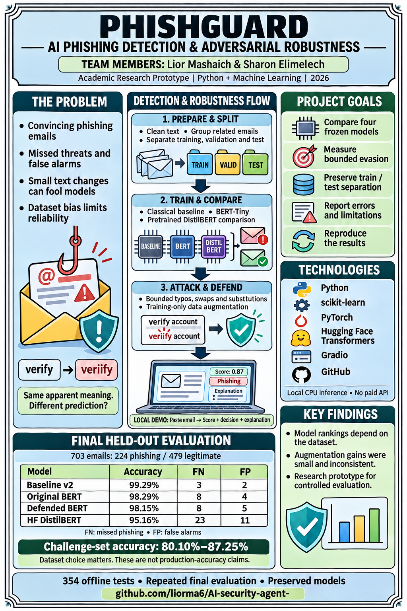

# PhishGuard project poster

Prepared November 17, 2026 for **Lior Mashaich and Sharon Elimelech**. The illustrated portrait layout follows the visual organization of the student's previous project poster: decorative frame, three columns, colored section panels, workflow arrows and an illustrated demonstration. Its content describes PhishGuard only. No mentor or institution is inferred from the earlier project.

The image is 1024 x 1536 pixels. Local deliverables are `PhishGuard-Poster.png` and a one-page A4 `PhishGuard-Poster.pdf` in the project's outputs directory. The PDF embeds the same image without altering its pixels; it is not a vector or higher-resolution version. The illustration was AI-generated and its visible names, sections and numerical table were reviewed against the project reports. The small laptop display and decorative chart are illustrations, not measured UI output or additional experimental results.

## Poster content

**Problem:** convincing phishing emails, missed threats, false alarms, sensitivity to small wording changes and dataset bias.

**Workflow:** prepare and group messages; keep training, validation and test separate; train and compare the classical baseline and transformers; perform bounded text perturbations and training-only augmentation; demonstrate frozen local inference.

**Technology:** Python, scikit-learn, PyTorch, Hugging Face Transformers, Gradio and GitHub. Inference runs locally on CPU without a paid API.

**Final held-out evaluation:** 703 messages, including 224 publisher-labeled phishing and 479 legitimate messages. Values come from the [frozen final report](reports/final-evaluation.json).

| Model | Accuracy | Missed phishing (FN) | False alarms (FP) |
| --- | --- | --- | --- |
| Baseline v2 | 99.29% | 3 | 2 |
| Original BERT | 98.29% | 8 | 4 |
| Defended BERT | 98.15% | 8 | 5 |
| HF DistilBERT | 95.16% | 23 | 11 |

The poster also reports 80.10%-87.25% accuracy on the different challenge cohort. It explicitly states that dataset choice matters and that these are not production-accuracy claims. Augmentation gains were small and inconsistent. The footer records 354 offline tests, a repeated final evaluation and preserved models. See the [final evaluation and review limitations](final-evaluation.md) and [current comparison](current-comparison.md) for the complete denominators, provenance, uncertainty and label limitations behind the concise visual.
