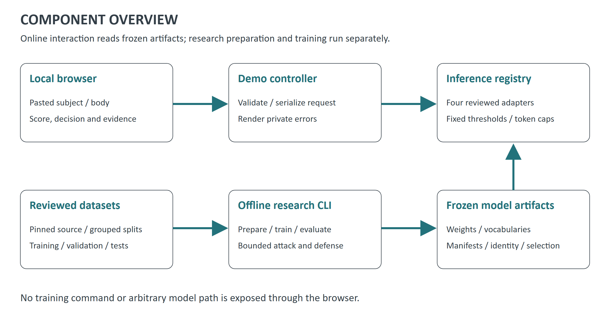
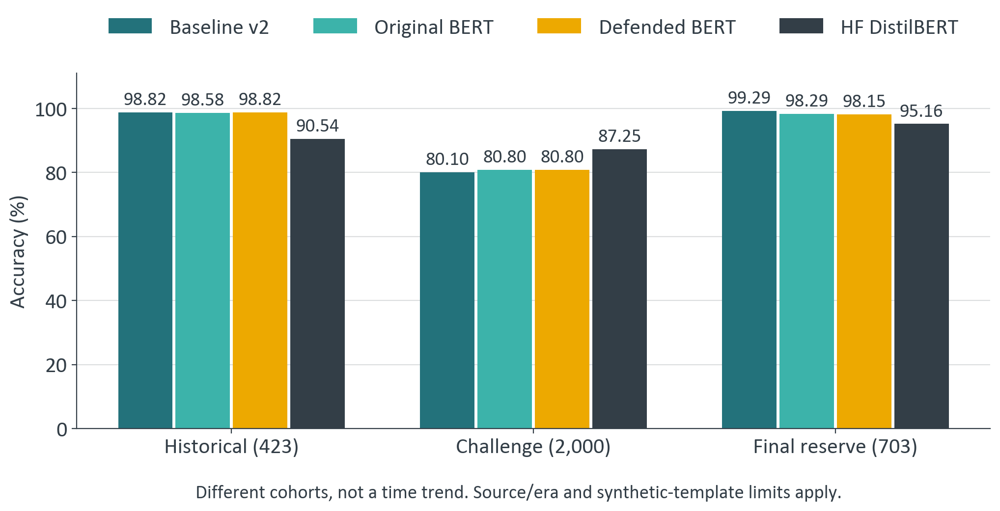
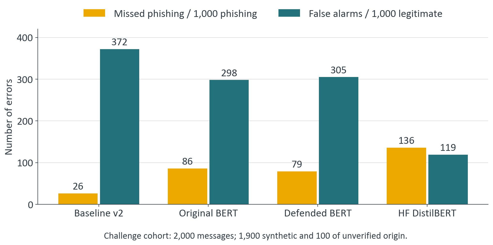
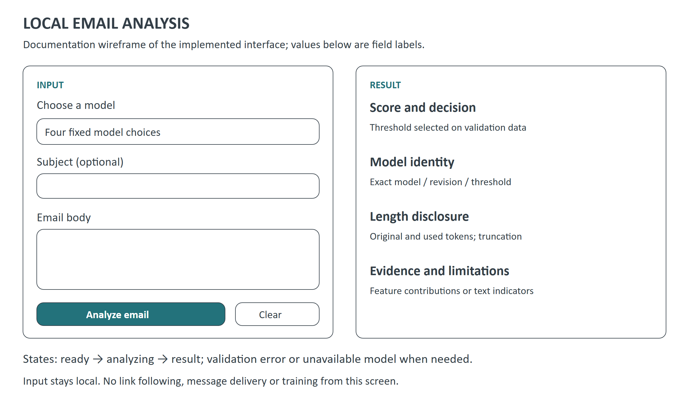

# PhishGuard - Final Project Presentation

Course-template content and speaker notes. Student identifiers are private local export fields and are not written here.

## 1. PhishGuard

Phishing detection and controlled adversarial robustness

- Lior Mashaich & Sharon Elimelech
- Supervisor: Zimon Roi
- HIT | AB- Ai Security | November 17, 2026
- An academic research prototype with a local email demo.
- Student IDs: omitted from public source; supplied through the private export profile.

Speaker notes: Introduce the research question and the two students. Development and documentation were AI-assisted; students must review and explain the implementation.

## 2. Table of Contents

Course-template sequence

- Software overview, goals, processes, modules and deliverables
- Specification requirements, algorithms and software
- Screenshots, measured graphs and interface mockup
- Progress against the plan, unexpected problems and responses
- Conclusions and directions for further development

Speaker notes: The presentation follows the supplied course template. The final template slide contains design instructions and is not a project-content slide.

## 3. General description of the software

English email-text classification and controlled robustness research

- Goals: compare detection, false alarms, controlled evasion and defense costs.
- Processes: grouped preparation, training/selection, frozen evaluation and local inference.
- Modules: datasets, four classifiers, perturbations, verification and Gradio demo.
- Products: runnable code/demo, reports, project book, One Pager, poster and presentation.

Speaker notes: PhishGuard is an academic local prototype. No mailbox ingestion, automatic blocking, attachment execution or production-email accuracy claim is provided.

## 4. One pipeline, two separate workflows

Offline experiments produce frozen artifacts; the UI only runs inference.

- DATA: reviewed sources, inert extraction, deduplication and grouped splits.
- MODELS: classical baseline, pretrained comparison, fine-tuning and defense.
- EVALUATION: frozen clean inputs, bounded variants, metrics and verification.
- DEMO: paste text, select a model, inspect score, decision and evidence.

Speaker notes: Explain why no training, email transmission or link following is available from the demo. Discuss the trust boundaries in the STRIDE chapter.

## 5. How the components communicate

Separate inference, research workflows and frozen artifacts.

Speaker notes: Use the component overview for an oral explanation. The detailed component and sequence UML are in chapter 7. The demo does not expose training or arbitrary model paths. The application uses versioned local files, not a user database.

## 6. Requirements: data and detectors

PG01-PG05 | Specification requirements mapped to evidence.

| ID | Requirement | Evidence |
| --- | --- | --- |
| PG01 | Learn the foundations | Learning record; personal evidence remains open |
| PG02 | Collect and prepare data | Pinned sources, grouped splits and manifests |
| PG03 | Classical ML baseline | TF-IDF + logistic regression; preserved v1/v2 |
| PG04 | Pretrained HF comparison | Pinned DistilBERT; identical evaluation IDs |
| PG05 | Fine-tune a transformer | BERT-Tiny; validation selection and full repeat |

Speaker notes: Map these rows to project-book section 3.18. Distinguish implemented artifacts from each student's remaining learning evidence. The external phishing classifier and the general encoder we fine-tuned are different models.

## 7. Requirements: evaluation and product

PG06-PG10 | Explain both delivered behavior and its limits.

| ID | Requirement | Evidence |
| --- | --- | --- |
| PG06 | Controlled text evasion | Three edit families, lineage and query caps |
| PG07 | Measure degradation | Clean/fixed/directed results and candidate ASR |
| PG08 | Evaluate a defense | Training-only augmentation; inconsistent gains |
| PG09 | Pasted-email web demo | Local UI, score, evidence and checked error states |
| PG10 | Report and presentation | Frozen final report, project book and this deck |

Speaker notes: The defense requirement is implemented and measured. Do not present it as a guaranteed improvement. The One Pager, poster, source and links handoff support the additional submission checklist.

## 8. Four preserved candidates

Architecture and training history are different.

| Candidate | How obtained | Threshold | Text budget |
| --- | --- | --- | --- |
| Baseline v2 | TF-IDF + logistic regression | 0.31 | Full accepted text |
| Original BERT | Locally fine-tuned BERT-Tiny | 0.69 | 256 tokens |
| Defended BERT | Separate augmentation continuation | 0.07 | 256 tokens |
| HF DistilBERT | Existing pretrained phishing classifier | 0.45 | 512 tokens |

Speaker notes: The downloaded phishing classifier is distinct from the general BERT-Tiny encoder we fine-tuned. Thresholds were validation-selected, not tuned on the final reserve. Scores are not calibrated probabilities.

## 9. Keep development separate from evidence

Groups and derived variants stay together.

| Partition | Messages | Purpose |
| --- | --- | --- |
| Training | 3,261 | Fit the current local models |
| Validation | 745 | Select checkpoints and thresholds |
| Retrospective benchmarks | 423 + 2,000 | Historical and mainly synthetic challenge |
| Final reserve | 703 / 432 groups | Frozen evaluation after all choices |

Speaker notes: The final reserve has 479 legitimate and 224 phishing messages. It was held out from local selection, but shares source families and years with development. It is not a new representative real-world inbox.

## 10. The evaluation was frozen first

Protocol and executable code committed before reserve scoring.

- Freeze commit: 77c4a17. It binds 96 source/reference files and 79 preserved inputs.
- All four models scored the same 703 clean messages with existing thresholds.
- The three trained candidates used the same seed-9042 attack bank.
- No refitting, relabeling, threshold changes or test-based model replacement.

Speaker notes: Show the protocol commit and final report in GitHub. Explain the clean-worktree gate, file hashes, development-overlap rejection and frozen post-score review selection.

## 11. Controlled evasion, not unrestricted attacks

A fixed, inspectable search budget.

- Three operations: duplicate a letter, swap internal letters, substitute a listed word.
- At most 3 changed words and 10% of body words; first 1,500 body characters only.
- Protect URLs, addresses, numbers, markup, capitalization and listed negations.
- 5,853 candidates; at most 12 candidates plus 1 clean query per message/model.
- Automatic constraints do not certify that every candidate preserves meaning.

Speaker notes: The generator never sees gradients or model scores. Each model scores the same finite candidate bank. Original messages are included in minimum-score selection; legitimate originals stay clean in directed-evasion metrics.

## 12. Did augmentation help?

A separate preserved checkpoint, evaluated without retuning.

- Original / defended candidate ASR: 2.31% / 1.39%.
- Common clean-detected phishing: 215; newly evaded original / defended: 4 / 3.
- Compare clean errors, fixed corruption and fresh search together.
- Continued training and augmentation are combined; no clean-only continuation control.
- One seed and one finite search cannot establish universal robustness.

Speaker notes: Use common eligibility to reduce the denominator mismatch. Explain the paired whole-group clean contrast and ASR uncertainty. Do not attribute every difference causally to augmentation.

## 13. Verification is part of the deliverable

Separate software correctness from model-quality evidence.

- 354 offline tests, including final-freeze and leakage guards.
- Two full final runs: identical prediction and candidate-bank bytes.
- Independent confusion / ASR / query recounts and unchanged 79 input files.
- Original neural tensors and all frozen thresholds remain unchanged.
- Windows + Linux CI; local demo and desktop/mobile browser checks.

Speaker notes: A complete repeated run demonstrates numerical reproducibility in this environment, not new independent statistical evidence. Reproduction instructions and all aggregate reports are versioned.

## 14. The local demonstration

Choose a model, paste English email text, inspect the result.

- 127.0.0.1:7860 | local inference
- Score, decision, model identity and truncation
- Baseline term contributions; labeled text indicators
- No link fetching, message delivery or saved submissions
- Not flagged does not mean safe

Speaker notes: Use invented public examples for the live demo. Show a normal result, a model change, the identity panel, an overlength error and Clear. Scores across models are not directly comparable.

## 15. The same demo on mobile

Actual stage-8 Chromium capture of the empty ready state.

- The form and result stack vertically on a narrow screen.
- The same four model choices and validation rules apply.
- The result area is ready; no prediction is shown in this capture.
- Clear resets the displayed form and result.

Speaker notes: This is the recorded browser screenshot, not a generated mockup. Open the full resolution image or live UI to inspect small text. The form is empty and contains no email content. No new browser-verification run is claimed here.

## 16. Changing the dataset changes the result

Do not average different cohorts into one claimed product accuracy.

Speaker notes: The historical cohort has 423 messages; the challenge has 2,000 and is mainly generated; the reserve has 703 held-out messages. The pretrained classifier had 87.25% challenge accuracy but missed 136 of 1,000 phishing messages. Source and template effects matter.

## 17. Different errors have different costs

Challenge cohort | 1,000 phishing and 1,000 legitimate messages.

Speaker notes: Read the two error counts separately. The pretrained classifier misses 136 phishing but produces 119 false alarms. The baseline misses 26 but produces 372 false alarms. The challenge is mainly synthetic; this is not an inbox forecast.

## 18. Final clean results

703 held-out messages: 224 phishing and 479 legitimate.

| Model | Accuracy | Phishing recall | Missed phishing | False alarms |
| --- | --- | --- | --- | --- |
| Baseline v2 | 99.29% | 98.66% | 3 | 2 |
| Original BERT | 98.29% | 96.43% | 8 | 4 |
| Defended BERT | 98.15% | 96.43% | 8 | 5 |
| HF DistilBERT | 95.16% | 89.73% | 23 | 11 |

Speaker notes: Read counts as well as accuracy. Compare the two error types explicitly. These are source-conditioned held-out results; the same models behaved differently on the challenge dataset. Group-based intervals and per-source results are in the report.

## 19. What happened under the fixed budget?

Candidate ASR counts newly evaded, initially detected phishing.

| Model | Clean recall | Attacked recall | New misses / detected | Candidate ASR |
| --- | --- | --- | --- | --- |
| Baseline v2 | 98.66% | 98.66% | 0 / 221 | 0.00% |
| Original BERT | 96.43% | 94.20% | 5 / 216 | 2.31% |
| Defended BERT | 96.43% | 95.09% | 3 / 216 | 1.39% |

Speaker notes: ASR is conditional: its denominator is initially detected phishing, including examples without candidates. It is not the percentage of all mail. Pretrained DistilBERT was not evaluated under attack. The three models each used 6556 total queries.

## 20. Review errors without changing the test

A bounded, deterministic post-score review.

- Reviewed 11 unique clean cases and 3 attack cases.
- Publisher labels remain fixed in primary metrics, even when context is incomplete.
- All 3 attack edits preserve meaning; the original phishing identity is ambiguous.
- No independently confirmed malicious-evasion lower bound above zero.
- AI-assisted inspection is not exhaustive independent human annotation.

Speaker notes: The three reviewed defended successes are short sharing/account notifications. Their typos preserve meaning, but available text cannot independently confirm a phishing identity. Thus 3/216 is publisher-label-dependent candidate ASR. Keep labels unchanged and do not call these confirmed real-world malicious evasions. Raw text stays local. Explain nonidentifying clean-error themes from the review report. Distinguish a model mistake, missing evidence, and an uncertain publisher label. Students should independently review the bounded sample.

## 21. The interface contract

Documentation wireframe of implemented behavior, not an earlier design artifact.

Speaker notes: Walk through model selection, optional subject, body, Analyze and Clear. Explain the Ready, Analyzing, Result, Validation error and Model unavailable states. This is a schematic, while the following images are actual browser captures.

## 22. Project progress schedule

Original milestone sequence compared with the actual project record

| Planned package | Actual project outcome | Comparison with plan |
| --- | --- | --- |
| W01-W03: foundations/data | Contracts, manifests and grouped splits | Implemented; individual review open |
| W04-W05: baseline/HF | Baseline, HF comparison and audits 4a/4b | External audit and refresh added |
| W06-W08: detector/robustness | BERT-Tiny, evasion and defense measured | Small, inconsistent defense gains |
| W09-W10: demo/final | Demo checked; 703-message run repeated | Materials ready; student review open |

Speaker notes: The original plan used relative packages, without dated baseline deadlines. A numerical early/late or on-time claim is unsupported. Actual implementation and experiment history is recorded in November 2026. The November-July student calendar was added afterwards; it is not the original implementation baseline. See docs/implementation-plan.md and docs/stage-log.md.

## 23. Student learning and contribution schedule

Confirmed November 2026-July 2027; 50 responsibility units per student

| Period | Learning / responsibility | Individual evidence |
| --- | --- | --- |
| November 2026 | W01-W02: foundations, contracts and threats | Five foundation leads per student; code/test walkthrough |
| December-February | W03-W05: data, baseline and pretrained comparison | Ingestion/grouping, training/metrics and audit notes |
| March-May | W06-W08: transformer, evasion and defense | Training, bounded edits, ASR and defense review |
| June-July 2027 | W09-W10: demo, final interpretation and handoff | Demo checks, personal reflection and presentation review |

Speaker notes: The calendar assigns personal study and review of existing AI-assisted outputs. Eighteen log entries remain planned until actual dates and evidence are supplied. It does not move completed experiments into future months or create a new untouched reserve. Lior Mashaich and Sharon Elimelech each have 50 planning units, not logged hours.

## 24. Unexpected problems

Observed research and implementation difficulties

- High internal accuracy did not transfer consistently to external cohorts.
- A reviewed example crossed a regrouping boundary in the refresh study.
- Long messages exceeded transformer token limits; some labels lacked context.
- Augmentation produced small, inconsistent robustness gains and clean costs.

Speaker notes: These issues are documented in the external audit, refresh, fine-tuning, defense and final review. They are not erased by stronger source-matched final accuracy.

## 25. Coping and Solving

Responses, retained evidence and remaining limitations

- Add external evaluation; report cohorts and error types separately.
- Disclose the boundary deviation; exclude the reviewed family in later comparisons.
- Show token truncation and review ambiguity without changing final labels.
- Preserve the original models; compare clean, fixed and fresh attack outcomes.

Speaker notes: These responses improve traceability and interpretation; they do not prove domain-general detection or a universally effective defense. Future causal claims need a clean-only continuation control and independent evidence.

## 26. Submission materials and demonstration

A traceable handoff for review, reproduction and presentation.

- One Pager, eight-chapter specification and English PowerPoint with notes.
- Measured reports, graphs, screenshots, interface wireframe and poster.
- GitHub source, source-only ZIP and local installation/demo instructions.
- Personal learning/review evidence and actual course submission remain open.

Speaker notes: Repository: https://github.com/liorma6/AI-security-agent-. Use docs/submission.md and docs/submission-review.md. No recorded/published YouTube link exists in the verified package. Research datasets and learned weights are excluded from the code ZIP.

## 27. Conclusions for further development

A reproducible prototype with clear research limits

- Model preference depends on the cohort, missed phishing and false-alarm costs.
- Collect contemporary, independently reviewed data containing both classes.
- Evaluate multiple seeds and a clean-only continuation control for the defense.
- Use new held-out evidence before tuning; never recycle the consumed final reserve.

Speaker notes: Final clean accuracy spans 95.16%-99.29%, while challenge accuracy spans 80.10%-87.25%. The local demo supports explanation and comparison; it is not a deployed mailbox protection service. Students must understand, review and present the AI-assisted implementation.
