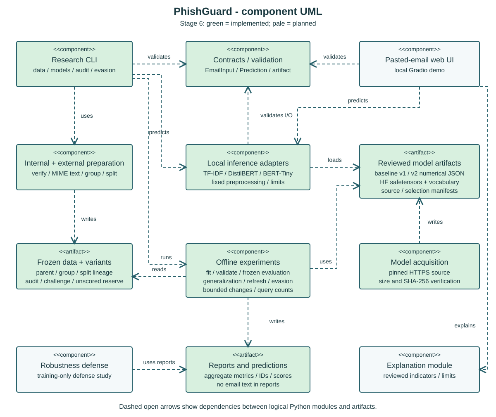
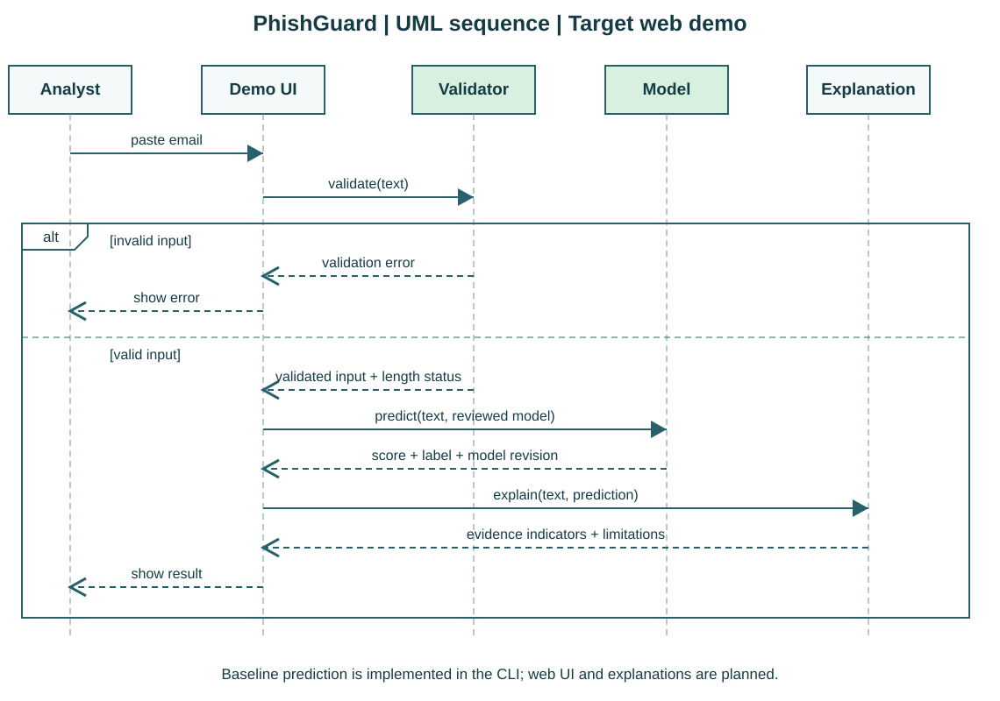

# PhishGuard - Project Book

Revision 1.9 - November 14, 2026 - Frozen final evaluation and submission materials

Team: Lior and Sharon Elimelech. Course-aligned proposal based on Project2_PhishGuard.docx and the student's eight-chapter checklist.

Status: STAGE 9 COMPLETED AT IMPLEMENTED SCOPE. All twelve milestones (0-9 plus 4a/4b) are implemented and checked. The final protocol was committed before all 703 reserve messages were scored, and the complete evaluation was reproduced without changing existing models or thresholds. English final reports, demo/reproduction instructions and presentation materials are prepared. Student review and course submission remain human responsibilities.

Chronology: stage-specific descriptions below record what was known at that stage. Statements that the reserve was unscored describe stages 4a-8; chapter 6.11 records its first scoring in stage 9. It is now consumed evaluation evidence, never a new training or tuning set.

## 1. Background

Phishing emails attempt to persuade recipients to disclose information or perform a harmful action. Text classifiers can help flag suspicious messages, but changes to wording, spelling or characters can alter model predictions even when the harmful intent remains. This project studies that gap between apparent test performance and robustness under controlled text changes.

The supplied brief describes a company receiving many emails and needing both a detector and evidence about whether it can be bypassed. The academic deliverable is a reproducible comparison of detection and robustness, plus a simple demonstration. It is not a production mail gateway and will not send emails, collect credentials or test against real recipients.

### 1.1 Foundations studied over two weeks

The students report studying the concepts below over a two-week period. Exact calendar dates and individual study artifacts were not supplied. Section 8 organizes that reported learning without inventing dates, completed exercises or individual authorship. Crypto and TLS knowledge supplies security background; Python, text preprocessing, TF-IDF and model evaluation remain additional task-specific foundations.

| Concept | Meaning | Relevance and limitation |
| --- | --- | --- |
| Cryptography | Methods for confidentiality, integrity, authentication and signatures; encryption is one part of the field. | Explains security properties, not whether a message is persuasive or fraudulent. |
| Symmetric encryption | The communicating parties use a shared secret for encryption/decryption. | Efficient protection of data; key establishment and handling remain important. |
| Asymmetric cryptography | Uses a public/private key pair; particular schemes support signatures, encryption or key agreement. | These are distinct operations; one algorithm need not support all of them. |
| Symmetric and asymmetric keys | A shared secret differs from a public/private pair. TLS commonly uses asymmetric mechanisms for authentication/key establishment and symmetric traffic keys. | TLS 1.3 also supports pre-shared-key modes; certificate-based authentication is not universal. [R1] |
| Algorithm and cipher | An algorithm is a procedure. A cipher is an encryption/decryption algorithm, such as AES. | TLS is a protocol combining cryptographic mechanisms, not a single cipher. |
| Hash function | Produces a fixed-size digest for algorithms such as SHA-256. It is not reversible encryption. | Useful for artifact and dataset identifiers. An unkeyed digest alone does not authenticate a sender. [R2] |
| HMAC | A message authentication code combining a hash function and a shared secret. | Supports integrity and shared-key authentication; it is not a publicly verifiable digital signature. [R3] |
| Salt | A per-password random value stored with a password-hashing result. It need not be secret. | Use a dedicated, costed password-hashing scheme; ordinary SHA-256 alone is unsuitable. No login system is required for the initial local demo. [R4] |
| TLS | Establishes an authenticated, confidential channel with integrity protection; a handshake establishes parameters and keys. | Protects transport. It cannot establish that email content is benign. [R1] |
| Digital certificate | An X.509 structure binding identity information to a public key, usually signed by a CA. | A common issuance flow uses a key pair and CSR; validation includes identity, validity and a trusted chain. [R5] |
| CA | A certificate authority issues/signs certificates under an identity-validation policy. | Trust anchors depend on the selected client/application trust store. [R5] |
| CRL | A signed list of certificates revoked before their normal expiry. | It is published by a CA or authorized issuer. Revocation and expiry are distinct concepts in the security learning record. [R5] |
| Model | A learned mapping used to predict labels or scores from inputs. | Review data, label meanings, intended use and measured performance; a score is not a guarantee. [R6] |
| AI agent | A model-based system using tools/actions to pursue an objective. | An autonomous agent is not required by the PhishGuard brief; the classifier can be a bounded function. [R7] |
| Generative AI | Models that generate content such as text, code, images or audio. | An LLM rewriter is optional in the brief. It is not needed for the first attack harness or a grounded explanation. [R8] |
| Hugging Face | A platform and ecosystem for models, datasets, libraries and learning material. | Study the LLM course before the agents course, and inspect model/dataset cards and licenses. [R6-R8] |

### 1.2 Terminology for this project

TF-IDF converts text into weighted features; logistic regression supplies the required classic-ML classifier. A transformer is a neural architecture used by many pretrained language models. Fine-tuning updates an existing model for the target task. Adversarial evasion changes an input to induce an incorrect prediction while retaining its relevant label. Robustness is evaluated under a declared threat model and attack budget, rather than assumed from clean accuracy. [R6, R9]

## 2. Work objectives

The main objective is to build a phishing-email detector and measure how controlled text perturbations affect it, then evaluate a defense. The final demonstration accepts pasted email text and returns a phishing score, a decision, model identity and an explanation tied to observable evidence.

| Objective | Acceptance evidence |
| --- | --- |
| Establish a reproducible dataset | Licensed source manifest, label definition, deduplication and frozen grouped train/validation/test splits |
| Build the required baseline | TF-IDF plus logistic regression, reproducible configuration and held-out metrics |
| Compare a pretrained Hugging Face classifier | Documented checkpoint, revision, compatible label mapping and comparison on the same test protocol |
| Fine-tune a small transformer | Training configuration, seeds, checkpoint manifest and evaluation; stage 5 implements Google BERT-Tiny |
| Measure evasion | Offline perturbation harness, validity review, fixed budget and paired clean/perturbed predictions |
| Evaluate a defense | Training-only augmentation or another declared defense, with clean and attacked evaluations |
| Deliver an understandable demo and report | Pasted-email workflow, bounded input, evidence-based explanation and comparative presentation |

Stages 3-4 provide measured baseline/pretrained comparisons. Stage 4a adds an external generalization audit in chapter 6; it is a cross-source stress test, not a representative contemporary-inbox study. Stage 4b adds real-mail development data and a separately frozen baseline v2, with an independent challenge and explicit generalization limits. Stage 5 adds the fine-tuned transformer and paired clean-text comparison. Stage 6 measures sensitivity to declared bounded text changes. Stage 7 adds a separate augmentation defense and fixed/fresh comparisons; broader robustness remains unestablished. Thresholds are selected using validation data only; report trade-offs and unsuccessful experiments without choosing conclusions in advance.

### 2.1 Experimental questions and metrics

Compare the baseline, the selected pretrained classifier, the fine-tuned model and its defended version. Report accuracy, phishing precision/recall/F1, legitimate-email false-positive rate, confusion matrices, class counts, inference time and resource conditions. Use the same held-out originals for paired clean/perturbed comparisons.

Attack success rate (ASR) is the fraction of eligible phishing originals correctly detected by the evaluated model for which at least one valid perturbation causes a legitimate prediction within the attack budget. Report numerator, denominator, valid-perturbation coverage and query counts. When validity is supported only by automatic constraints, label this candidate ASR and report separately reviewed evidence; do not imply exhaustive semantic certification. Different models may have different eligible sets; do not compare ASR numbers alone as if their denominators were identical.

For the defense comparison, report results on fixed saved variants and the same evaluation cohort, and separately report a fresh attack search against the defended model using the same budget. Keep attack tuning and defense training away from the final test set. Group an original email, duplicates, its campaign/template relatives where identifiable and all derived variants into one split. Fit TF-IDF and preprocessing statistics on training data only. [R10]

## 3. Technical requirements

### 3.1 Requirements from the supplied brief

The PG requirements describe the complete assignment. Stages 1-5 supply the environment, contracts, PG02 dataset evidence, the trained/evaluated PG03 baseline, the PG04 pretrained comparison and the PG05 fine-tuned detector. Stage 6 implements bounded PG06 transformations and qualified PG07 degradation measurements. Stage 8 implements PG09 with a local Gradio UI, explanations and checked privacy/error states. Stage 7 implements the PG08 augmentation defense and compares clean cost, fixed variants and fresh equal-budget searches; conclusions remain limited to these declared protocols. PG01's task-specific learning continues alongside implementation. The remaining end-to-end acceptance evidence is planned.

| ID | Requirement | Verification |
| --- | --- | --- |
| PG01 | Learn Python, phishing and text classification | Learning notes and a small reproducible preprocessing exercise |
| PG02 | Collect public phishing and legitimate email data | Provenance, license, label audit and frozen split manifest |
| PG03 | Implement TF-IDF plus logistic regression | Training/inference command and baseline evaluation |
| PG04 | Use a pretrained Hugging Face text classifier for comparison | Checkpoint metadata, task-compatible labels and comparison report |
| PG05 | Fine-tune a small transformer | Repeatable run configuration and saved model artifact |
| PG06 | Implement controlled email-text evasion | Typo, character-swap and substitution variants with traceable originals; optional rephrasing |
| PG07 | Measure degradation under attack | Paired predictions, clean/attacked metrics and ASR with denominators |
| PG08 | Improve robustness and evaluate again | Documented defense and independent evaluation of benefits and costs |
| PG09 | Provide a simple pasted-email web demo | Risk score, explanation, model version, empty/error/length-limit states |
| PG10 | Deliver comparative report and presentation | Prepared: final aggregate report, independent reproduction, demo/submission guide and 16 English slides; personal review and actual submission remain open |

The brief lists Python, Hugging Face Transformers/Datasets, scikit-learn, Google Colab, Gradio/Streamlit and GitHub. DistilBERT is an example, and LLM-assisted rewriting is explicitly optional. The required final deliverables are baseline and fine-tuned detectors with a demo, a controlled adversarial script, a comparative report and a presentation.

### 3.2 Proposed implementation choices

Use a modular Python pipeline with a Gradio demo. Keep dataset preparation, feature extraction, training, perturbation, evaluation and inference separate. Use local versioned files for manifests and aggregate results. The offline experiment pipeline prepares reviewed artifacts; the demo loads a selected artifact for inference. Container packaging may be added when it makes the completed demo easier to reproduce.

The internal training source is the publisher-English subset of E-PhishLLM, with plain-text subject/body fields. Stage 4a adds bounded offline MIME extraction for reviewed external archives; it does not add live mailbox integration, attachment analysis, sender authentication or multilingual classification. The foundation supports Python 3.11-3.13; local development uses Python 3.13.16, uv 0.13.1 and a locked dependency environment. It uses Pydantic for strict record validation, pytest for tests and Ruff for code checks. The baseline uses scikit-learn 1.9.1 and locked numerical dependencies on CPU. The pretrained runtime pins PyTorch 2.15.0, Transformers 4.57.6 and safetensors 0.8.0; the audit pins langdetect 1.0.9 and truststore 0.10.5. CI covers Windows/Linux and Python 3.11/3.13. Full research-corpus scoring was measured locally on Windows. Keep large checkpoints and datasets outside Git and record provenance and digests in manifests.

Stage 2 selected synthetic E-PhishLLM with a pinned publisher MIT declaration, explicit label mapping and a sample audit. Stage 4a evaluates the unchanged baseline on Nazario phishing archives and SpamAssassin legitimate mail, documenting their distinct terms and source/era limitations. Stage 4 selected a pretrained classifier with explicit phishing/legitimate labels and documented source limitations. A generic sentiment model cannot be evaluated by relabeling positive/negative sentiment as safe/phishing. A base encoder without a trained classification head also does not provide a ready phishing detector.

### 3.3 Quality, security and reproducibility requirements

| ID | Proposed requirement | Acceptance |
| --- | --- | --- |
| Q01 | Trace every dataset/model/experiment revision | Manifest with source revision, digest, seed, configuration and split IDs |
| Q02 | Prevent leakage | No group or derived variant crosses splits; training alone fits transformations |
| Q03 | Preserve email privacy | No raw pasted email logging or storage by default; licensed/redacted fixtures only |
| Q04 | Bound resource use | Implemented 20,000-code-point combined email and 262,144-byte JSON limits, with rejection and no truncation; pretrained inference enforces 512 tokens/batches of eight, while fine-tuned inference uses 256 tokens/batches of 16, both with disclosed truncation; stage 6 caps queries at 13 per original/model; web concurrency controls remain planned |
| Q05 | Treat email content as inert data | Render escaped text; do not open links, send mail or execute attachments/instructions |
| Q06 | Load reviewed model artifacts | Pin revisions, verify manifests and disable unreviewed remote code; avoid untrusted serialized executables |
| Q07 | Explain uncertainty | Display a model score, threshold and model identity; do not claim a calibrated probability without calibration evidence |
| Q08 | Keep training/evaluation distinct from the demo | Offline runner owns training and perturbation; UI cannot invoke arbitrary scripts |
| Q09 | Reproduce a clean run | Document installation, test command, data preparation and evaluation with resource limits |

### 3.4 Data design

| Record | Required information |
| --- | --- |
| EmailExample | ID, preserved text, source label, source/license, group ID, split and optional parent ID |
| ModelArtifact | Model/tokenizer revisions, label mapping, preprocessing configuration, manifest digest and threshold |
| Perturbation | Original ID, operation, seed, budget/query count, changed text and validity review |
| Prediction | Example/variant ID, model revision, score, decision, threshold and elapsed time |
| ExperimentRun | Dataset/split versions, compared models, defense configuration, metric counts and artifact references |

Separate model indicators from factual claims about the sender. A baseline explanation can show influential TF-IDF features; a transformer explanation needs a declared attribution or indicator method and limitations. Generated prose is optional and cannot replace measurement.

Stage 1 implements EmailInput, EmailExample, ModelArtifact, Prediction and UnavailablePrediction. [Contract details](contracts.md) define required fields, strict types, preserved text, explicit label mapping, finite scores and threshold/label consistency. Stage 3 supplies baseline inference and separately verifies model bytes, dimensions, mapping, threshold, runtime version and protocol digest before use. The contract-only validator still checks record structure without loading model files. Stage 6 implements replayable local perturbation records with parent/group/split lineage and text-free score reports. A unified ExperimentRun contract remains a future design. Synthetic fixtures document provenance and use unassigned splits; they are not a selected research dataset.

### 3.5 Implemented dataset preparation

The source is the authors' E-PhishLLM release, revision `dda1f1e0b155206a4f84915bf117012f960bdafe`, with a publisher-declared MIT license. It contains synthetic emails, not real inbox observations. Type 0 means legitimate and type 1 means phishing. Source digests, attribution, commands, quality results and limitations are maintained in the [dataset guide](dataset.md). [R12]

Of 16,616 source rows, 11,502 are flagged English and retained; 5,114 other-language rows are excluded. No selected row violates the input contract; normalized exact duplicates and conflicting exact labels number zero. Similarity/template grouping produces 10,564 groups, including 325 multi-message groups, with a largest group of 40. The seed-42 split contains 8,052 training messages (3,854 legitimate / 4,198 phishing), 1,725 validation messages (826 / 899) and 1,725 final-test messages (826 / 899).

Grouping combines normalized exact text, sufficiently long identical subjects, masked body templates and exact word-trigram Jaccard similarity of at least 0.90. Connected relatives and declared parent links remain together. These rules reduce detectable overlap but cannot establish complete campaign independence because the source supplies no campaign/profile IDs. Original accepted text remains unchanged. Stage 3 fits its TF-IDF vocabulary and IDF weights on the training partition only.

The [24-example label audit](dataset-label-audit.md) found 17 text-compatible and seven context-dependent examples. It was AI-assisted and is not a full label validation or completed student review. Labels remain the publisher's. A corpus-wide shortcut is also present: synthetic angle-bracket markers occur in 3,609 phishing messages and no legitimate messages. Before research training, stage 3 froze and applied label-independent removal of complete synthetic markers and their contents. Training/validation diagnostics confirm zero complete markers remain after this transformation. Do not tune preprocessing using final-test performance. Synthetic style, missing context and possible semantic overlap limit later conclusions.

The public source and processed JSONL files are kept on the local disk outside Git tracking. The repository stores a text-free frozen split manifest. A second preparation from a fresh verified download produced identical partition and manifest bytes. CLI verification checks file digests, membership, counts, provenance, unique IDs/text, similarity groups and parent lineage; the committed reference additionally anchors the expected bytes.

### 3.6 Implemented classical baseline

The baseline transforms each subject/body into word unigram/bigram TF-IDF features and fits logistic regression, with legitimate=0 and phishing=1. The fixed configuration uses a maximum of 30,000 features, minimum document frequency 2, sublinear term frequency, smoothed IDF, L2 normalization and L2-regularized logistic regression (C=1, LIBLINEAR, seed 42). All fitted vocabulary, IDF values and coefficients come from training data only. [R9, R13]

The versioned protocol was committed before research training. Training reads the train/validation partitions only; it does not open the final-test file. Validation selects the threshold maximizing phishing F1 on a fixed 0.05-0.95 grid with 0.01 increments and declared tie-breaks. There is no hyperparameter search or train+validation refit. The frozen model is evaluated in a separate command. Source digests and cleaned-text fingerprints reject inconsistent artifacts and exact cross-partition overlap.

The model is stored as strictly validated JSON vocabulary, numerical weights, threshold and provenance, with a separate SHA-256 manifest. Loading reconstructs scoring without deserializing executable objects. Missing or invalid artifacts return explicit errors/unavailable results. Inference neither saves pasted email nor follows its links. Model scores are not calibrated probabilities. [R14]

The [baseline guide](baseline.md) contains verified commands, the complete protocol, measured reports and limitations. Chapter 6 records the observed result and the subsequent transformer comparisons; robustness experiments remain separate future work.

### 3.7 Implemented pretrained adapter and comparison

Stage 4 uses the externally trained two-class DistilBERT `dima806/phishing-email-detection`, pinned to revision `310a5602280486e01dd60e37230980cfcc327b41`. The publisher card declares Apache-2.0. Explicit configuration labels map `SAVE EMAIL` to legitimate and `PHISHING EMAIL` to phishing; generic/extra labels fail. The full upstream training manifest is unavailable, so no verified non-overlap claim is made. [R15]

The source manifest verifies card/configuration/vocabulary/safetensors bytes. The local loader disables remote code, rejects incomplete classification heads and reconstructs a cased tokenizer from the supplied vocabulary and pinned base-tokenizer settings. Input uses the baseline's marker removal; token lengths and right truncation at 512 are disclosed. Weights stay fixed. Validation-only threshold selection is separate from final evaluation and bound by digests to model, dataset and baseline versions. Evaluation checks identical test IDs and reproduces the published baseline counts before comparing predictions.

The [pretrained guide](pretrained.md) records selection reasons, source limitations, commands and CPU resource conditions. This comparison preserves external weights; section 3.10 describes our separate fine-tuning of a general BERT encoder.

### 3.8 Implemented generalization audit

The separate audit runner loads the exact stage-3 model and threshold 0.44. It never fits vocabulary, coefficients or thresholds. Publisher files have pinned sizes/digests and verified HTTPS downloads. MIME extraction prefers inline plain text, falls back to inert HTML text, excludes attachments/embedded messages and rejects unusable or oversized content. Only confident English inputs are retained. No message links are opened. [R16-R17]

Preparation deduplicates inputs, groups detected relatives transitively and excludes external components related to any internal split. A fixed 70/30 whole-group allocation creates an audit partition and an unscored reserve. The text-free manifest and deterministic audit-only label sample were frozen before predictions. The reserve is read during automated preparation and hashed for integrity, but not manually reviewed or scored. Internal diagnostics report training/test gaps, broader relatives and feature associations without changing the model. External evaluation reports class metrics, balanced accuracy, group-bootstrap uncertainty and per-source results. See the [audit guide](generalization-audit.md) and [label review](external-label-audit.md).

### 3.9 Implemented data refresh and baseline v2

Stage 4b reuses the classical algorithm with a separate training corpus and artifact. The inspected external audit becomes development-only data. Additional legitimate mail comes from the publisher-ham portion of MeAJOR v2.0 (TREC 2005/2006/2007); additional phishing comes from Nazario's historical `phishing3.mbox`. Generic spam is excluded, not relabeled as phishing. These archives provide real-mail-derived examples but remain historical, source-dependent and publisher-processed. New source licenses are publisher CC BY 4.0; original SpamAssassin terms remain attached to its records. [R18, R16]

Before fitting, an excerpt review and integrity guards led to two corrections: narrow plain/HTML extraction repairs and removal of declared publisher entity placeholders, applied independently of class. Preparation unions both original and broader relatedness rules, known families and challenge templates. It excludes groups connected to every original synthetic row or any reserved row. Reserve access is limited to automated overlap checking; its saved bytes are unchanged. Original files and v1 behavior are preserved.

The real-mail-v2 manifest binds 3,261 training, 745 validation, 425 historical test and 2,000 challenge rows. V2 training fits vocabulary/IDF/weights only on training data; validation selects threshold 0.31 under the unchanged F1 policy. It uses no synthetic training examples. The separate challenge source is 95% template-generated, while its 100 original records have unverified provenance. Its metadata templates are grouped and it is never used for fitting or threshold selection. [R19]

A committed model-selection reference anchors weights, threshold, dataset and protocol before evaluation. Both models receive identical prepared inputs. Evaluation opens only test/challenge files and reports each separately with source subgroups, paired outcomes and group intervals. Baseline prediction selects v2 explicitly; v1 remains available. See the [refresh guide](baseline-refresh.md). Chapter 6 discloses a one-row inspection-boundary deviation and its sensitivity check; held-out-from-fitting is not synonymous with never inspected.

### 3.10 Implemented fine-tuned detector

Stage 5 fine-tunes Google's English uncased BERT-Tiny encoder, revision `30b0a37ccaaa32f332884b96992754e246e48c5f`, with publisher Apache-2.0 terms. It has two layers, hidden width 128 and two attention heads. A newly initialized legitimate/phishing head gives 4,386,178 trainable parameters. All encoder and head weights update locally; this is our task-specific fine-tuning of a general pretrained encoder, not the downloaded stage-4 phishing classifier. Its small size suits the existing CPU environment. The brief permits a small transformer and gives DistilBERT as an example. [R20]

The fixed protocol uses seed 42, five epochs, batches of 16, CPU float32 with four threads, AdamW at 0.00005 learning rate, 10% linear warmup/decay and gradient clipping at 1.0. The fixed uncased tokenizer right-truncates at 256 tokens, including special tokens, and reports original lengths. Baseline v2 retains full accepted text; the comparison therefore includes representation/pretraining/length differences, not architecture alone. No hyperparameter sweep or test-driven retry was performed.

Task fitting reads only the frozen 3,261 real-mail-v2 training rows. The 745 validation rows select the lowest-cross-entropy epoch, then its threshold using the existing F1 grid. A text-free selection reference was committed before benchmark scoring. Safetensors/configuration/vocabulary, source/protocol/data digests and development fingerprints bind the saved detector; safe loading validates numerical tensors, label mapping and files. Reloaded validation scores are identical. The selected encoder digest differs from the starting encoder, confirming actual fine-tuning.

The reviewed-ID registry excludes the complete two-row historical group containing the earlier inspected message. Both compared models receive the same remaining 423 rows. The separate challenge remains 2,000 rows. These previously scored cohorts are retrospective research benchmarks; neither contributes to gradients, epoch selection or threshold selection. The 703-message reserve remains unopened by training/evaluation and unscored. Before stage 9, freeze final detector, threshold, attack, defense and evaluation decisions; do not use final outcomes for retuning. Upstream pretraining membership and complete semantic non-overlap cannot be proven. See the [fine-tuning protocol, commands and model limitations](finetuned.md).

### 3.11 Implemented controlled evasion

Stage 6 adds a local, score-access robustness experiment for the unchanged baseline v2 and BERT-Tiny. The adversary can change an original body within fixed constraints and seek a phishing score below the existing threshold. The runner separates a goal, constraints, transformations and search, following the methodological decomposition of Morris et al.; it is our limited deterministic implementation, not a reproduction of a state-of-the-art attack. No message is sent, link followed, model trained or threshold changed. [R21]

The fixed seed-42 bank includes internal-letter duplication, adjacent internal-letter swaps and ten declared lexical substitutions. Every candidate starts from its original and changes at most three words and 10% of the alphabetic body-word count, rounded down. Only lowercase words ending within the first 1,500 body characters are editable. The subject, URL/email/domain spans, numeric tokens, markup/entities, capitalization and listed negation/control words are preserved. Automatic constraints do not prove that every context-dependent meaning or publisher label is correct.

Four proposals per family are hash-ranked and interleaved without model feedback. Duplicate/no-op/invalid outputs are rejected. Both models score the same bank with at most 12 candidates plus one clean prediction per original, without early stopping or hidden importance queries. A fixed-corruption view uses the same first candidate for both models/classes. Directed evasion chooses the lowest score for phishing originals only and leaves legitimate originals clean; its full-cohort false-positive rate is unchanged by construction. Candidate ASR includes every clean-detected phishing original in the denominator, even when no candidate exists. Common-eligible results and exact query counts make the comparison explicit.

Training-only preflight inspection is separate from bank preparation/evaluation, which open only the existing 423 historical and 2,000 challenge benchmark rows. They are known retrospective cohorts, including stage-5 post-score inspection evidence; no fresh-final-test claim is made. The original reviewed two-row family remains excluded. Each variant records parent, group, split, cohort, source label, seed, operation, offsets and digests. The committed bank reference and deterministic regeneration validate constraints/lineage before scoring; model development fingerprints reject cleaned-text overlap. The 703-message reserve remains unopened by the experiment and unscored. The [evasion guide](controlled-evasion.md) records the threat model, commands, validity policy and reproduction.

### 3.12 Implemented augmentation defense

Stage 7 trains a separately identified BERT-Tiny continuation using equal clean/perturbed training views. Fixed seeds 101/102 generate one constrained copy per training/validation parent; no benchmark variant is used for fitting. Three seed-42 epochs use AdamW at 0.00002, batch 16, the unchanged tokenizer/256-token limit and CPU float32 runtime. A pre-fit contextual sample review and immutable augmentation manifest are enforced before updates. The checkpoint minimizes equal clean/perturbed validation cross-entropy; its threshold uses clean validation F1 only. Original models and all prior data remain preserved.

The defense artifact binds its parent, protocol, augmentation/review digests and development fingerprints. Evaluation checks the fixed stage-6 bank and a separately frozen seed-43 equal-budget bank against baseline, original BERT and defended BERT. It reports clean cost, fixed corruption, parent-selected transfer, fresh candidate ASR, common eligibility, intervals and query counts. Existing benchmarks remain retrospective; the 703 reserve messages remain unscored. All variants stay local; the subsequently implemented demo is described in section 3.13. See the [defense guide](robustness-defense.md) and measured results in section 6.8.

### 3.13 Implemented local demo and comparison extension

Stage 8 supplies a Gradio 6.17.3 interface with a required body, optional subject, four-model allowlist, analysis and clear actions. It validates combined text before loading models, serializes inference, shows the unrounded-score decision at the frozen threshold, identifies the model revision and discloses truncation. The displayed 0-100 score is not a calibrated probability. Original BERT is the initial view for continuity, without selecting a winner from test outcomes.

Baseline explanations expose up to six signed TF-IDF-times-coefficient contributions; all models display explicitly noncausal text indicators. No LLM invents an explanation. Missing/tampered models return fixed unavailable messages with no score. HTML-like input remains inert, outputs are escaped and raw exception details are hidden. No email persistence, link following, attachment processing or training action exists in the interface. Loopback binding, private events, strict CORS, an eight-event queue, a 262,144-byte body limit, denied uploads and blocked project-file serving constrain the local demo. Runtime telemetry, monitoring, public sharing, MCP and PWA are disabled. Browser/server memory is not guaranteed securely erased by Clear. [R22, R23]

The separate `compare select` command reads only 745 validation messages to freeze the pretrained threshold at 0.45; `compare evaluate` scores the same 423 historical and 2,000 challenge inputs as the three current trained models. It preserves all weights and old thresholds, using the stage-4 tokenizer and 512-token inference policy. It never opens reserve text. See the [demo guide](demo.md), [same-cohort comparison](current-comparison.md) and sections 6.9-6.10.

### 3.14 Implemented frozen final evaluation

`phishguard final evaluate` loads reserve records only and verifies the committed freeze, clean tracked worktree, code/reference hashes, exact membership and unchanged model/data inputs. It rejects exact preprocessed overlap with local development fingerprints for originals and generated candidates. It does not open training/validation email files or call a fitting function. All final choices, budgets, thresholds, metric definitions and post-score sample rules are fixed before scoring. Tests use invented data only. Full original/candidate text stays in ignored local files; public reports contain aggregates and text-free review records. The final evaluator refuses existing output directories. See [protocol, measured outcome and limitations](final-evaluation.md).

## 4. STRIDE threat analysis

This threat model covers the intended PhishGuard system. Stage 1 implements bounded, strict input validation and input-free public errors. Stage 2 adds pinned source/file integrity, frozen splits, lineage checks and controlled source-only downloading. Stage 3 adds train-only fitting, held-out threshold selection, numerical JSON model validation, artifact digest checks and input-private prediction. Stage 4 adds reviewed safetensors-only loading, explicit model labels, checked tokenizer reconstruction, token/batch limits and digest-bound validation decisions. The broader controls below remain planned unless linked to implemented evidence in the stage log. STRIDE provides six categories for analyzing system threats. The specific threats, priorities and controls below are design judgments for this project. [R11]

Stage 4a additionally bounds raw messages and expanded archives, rejects unsafe archive members without extracting files, keeps HTML inert, verifies external membership and refuses a different model/threshold. Its evaluation loader does not open the reserve file. These controls address integrity, disclosure, resource exhaustion and unintended execution; they do not establish that publisher labels are correct.

Stage 4b adds bounded streaming source verification, protected-corpus overlap exclusion, separate model/selection references and tests proving that fitting does not open test/challenge and evaluation does not open development/reserve files. Its pre-fit leakage guard stopped an inconsistent split; the documented review-boundary deviation motivates a reviewed-ID registry for future regeneration.

Stage 5 adds a pinned general-encoder source, safetensors-only checkpoints, finite tensor/configuration checks, validation-only selection, a reviewed-family exclusion registry and fixed baseline identities. Training and evaluation have separate read boundaries, tested with forbidden partitions absent. Reproduction verifies preserved reserve/model bytes without parsing reserve content.

Stage 6 adds a frozen candidate-bank digest, deterministic regeneration, explicit edit/query bounds, parent/group/split lineage, development-overlap rejection and unchanged-model checks. Research variants remain local and inert. Evaluation never reads training/validation/reserve mail; integrity verification may hash bytes without parsing. Tests cover empty searches, exhausted budgets and invalid edit traces.

Stage 7 adds a pre-fit review gate, split-specific training/validation copies, immutable defended artifacts with parent identity, validation-only checkpoint/threshold selection and fixed/fresh equal-budget evaluation. Tests exercise training without benchmark files, scoring without development files and preserved parent bytes. Public reports contain metadata, not email excerpts.

### 4.1 Assets, actors and trust boundaries

Protect email content, labels and split integrity, model artifacts, credentials used for downloads, predictions, experiment manifests and compute availability. Actors are the local analyst, student researcher, an untrusted email author and external model/dataset publishers. The controlled perturbation runner represents the adversary only inside the experiment.

Boundary B1 separates pasted text from the UI/inference code. B2 separates external dataset/model downloads from reviewed local artifacts. B3 separates training data from validation/test data. B4 separates the demo process from filesystem secrets and offline training privileges. The initial deployment is loopback-only; shared hosting introduces an additional authentication and transport boundary that must be reviewed before publication.

| Category | Scenario and impact | Proposed mitigation | Verification and owner |
| --- | --- | --- | --- |
| S - Spoofing | A forged sender display name or a model result is treated as proof of identity; a shared demo could accept an unauthorized user. | Explain that text classification does not authenticate senders. Keep local operation; require authentication before shared deployment. | Verify result wording and local binding; test access controls if shared hosting is added. Lior leads, Sharon reviews. |
| T - Tampering | A dataset label/split or model artifact is altered, poisoning training or invalidating evaluation. | Review provenance, pin revisions and digests, freeze grouped splits, track label edits, keep test data outside training. | Reject manifest mismatch and group overlap. Sharon leads, Lior reviews. |
| R - Repudiation | A reported result cannot be traced to the model, data, configuration or perturbation that produced it. | Record run IDs, manifests, seeds, versions and aggregate counts without raw email content. | Reproduce a tiny reference run and trace every reported metric. Logs provide traceability, not guaranteed non-repudiation. Lior leads, Sharon reviews. |
| I - Information disclosure | Pasted email contains private information and is leaked through logs, saved examples or an external LLM request. | Disable raw-input logging/persistence, redact public fixtures and avoid external inference by default. | Use a unique test marker and verify it is absent from logs/files/outbound requests. Sharon leads, Lior reviews. |
| D - Denial of service | Oversized text, repeated requests or unrestricted attack loops exhaust CPU, GPU or memory. | Bound characters/tokens, inference concurrency, time and attack queries; return clear limit errors. | Boundary/over-limit tests, exhausted-budget test and measured resource checks. Lior leads, Sharon reviews. |
| E - Elevation of privilege | An untrusted checkpoint, dataset script or email instruction executes code or invokes privileged tools. | Use reviewed artifacts, disable remote code, avoid arbitrary paths/commands and treat text as data. Use a non-root container if deployed in Docker. | Reject unknown paths/artifacts and ensure email text never triggers execution or networking. Sharon leads, Lior reviews. |

### 4.2 Model evasion and residual risk

STRIDE does not replace the adversarial ML experiment. The perturbation harness specifically measures false negatives under bounded, label-preserving changes. Label preservation must be reviewed: changing a phishing request into a harmless message is not a successful evasion. Report invalid or ambiguous variants separately.

Residual risks include dataset bias, incomplete campaign grouping, novel attack styles, attribution limitations, poisoning that escapes provenance checks and false confidence in a score. A successful defense experiment supports claims only for the measured datasets, budgets and attack families. The demo provides decision support and does not automatically block mail or claim that a message is safe.

## 5. Unit tests

### 5.1 Current verification status

The repository contains the specification, contracts, dataset pipeline, classical baseline, pretrained comparison and generalization audit. The automated suite contains 354 tests: 80 foundation, 44 dataset, 51 baseline, 26 pretrained, 26 audit, 22 refresh, 18 fine-tuning, 25 evasion, 18 defense, four current-comparison, 26 demo and 14 final-evaluation checks. The stage log records the executed local, installed-package and CI outcomes. They cover synthetic fixtures, input limits, malformed JSON, provenance, mappings, score/threshold consistency, grouping, leakage, artifact integrity and private errors. Audit tests add MIME/HTML extraction, unsafe archives, deterministic English filtering, broader similarity checked against brute force, exclusion of relatives of every internal split, fixed model/threshold enforcement and evaluation with the reserve file absent and model fitting disabled. Documentation checks cover English content, links, tables, chapters and diagrams. The [stage log](stage-log.md) records verification and CI evidence.

Baseline tests cover train-only vocabulary/IDF fitting, threshold selection, exact metric counts, non-convergence, leakage, JSON model integrity, save/load numerical agreement and private predictions. Measured research-corpus results appear in chapter 6 and the linked reports. Passing tests and measured benchmark accuracy are distinct evidence.

Refresh tests cover inert extraction repairs, preserved ordinary text/attachments, strict ham-only ingestion, source integrity, partial-file preservation, transitive known families, the literal-subject grouping boundary, publisher marker removal, protected-corpus exclusion, audit/challenge separation, partition tampering, train/evaluation read boundaries, frozen-selection mismatch and private CLI errors.

Fine-tuning checks use an invented tiny BERT fixture with no model downloads. They verify actual encoder updates, training with test/challenge absent, validation selection, deterministic repeats, reload agreement, family exclusion, frozen comparison without fitting, artifact tampering, tokenizer truncation, bounded downloads and private CLI failures.

Evasion tests cover deterministic edits, protected spans, bounds, zero budgets, no-candidate outcomes, replay/tampering, inherited lineage, exact ASR/query denominators, common eligibility, bank reproduction and private CLI failures. Tiny frozen-model integration runs with training/validation files absent and optimizer updates disabled, and rejects model/threshold changes, development overlap and excess candidates.

Defense tests add split-scoped copies, deterministic lineage/seeds, pre-fit review rejection, parent preservation, validation-only selection, repeated training, tampered artifact rejection, separate evaluation read boundaries, equal query caps and private prediction errors.

### 5.2 Implemented PhishGuard unit-test matrix

The matrix below maps the implemented test goals. Stage 1 implements the input-validation parts of U01/U02, text-preservation part of U03, metadata-mapping part of U06, record-level threshold checks in U07, unavailable-result shape in U11 and CLI privacy part of U12. Stage 2 adds U03 grouping and U04 duplicate/derived-lineage separation checks. Stage 3 implements U05 feature leakage checks, baseline mapping/loading in U06/U11, actual thresholded inference in U07, classification metrics in U10 and baseline CLI privacy in U12. Stage 4 adds transformer label direction, actual tiny-transformer inference, unchanged-weight checks, token truncation, safetensors loading policy, validated selection and comparison checks for U06/U07/U10/U11/U12. Stage 5 adds train/validation read boundaries and actual fine-tuning/reload/frozen evaluation coverage to U04/U06/U07/U10/U11/U12. Stage 6 implements bounded perturbations (U08), query/empty-search handling (U09), ASR/paired metrics (U10) and lineage/integrity checks. Stage 7 extends U04/U06/U07/U09/U10/U11/U12 with separate augmentation, defended artifacts and fixed/fresh comparison. Stage 8 covers web input/length limits, private errors, escaped HTML output, model allowlisting, signed evidence and bounded local routes for U01/U02/U06/U07/U11/U12. Stage 9 adds committed-freeze, model preservation, membership/read-boundary, development-overlap, paired interval and deterministic review checks. Use small offline fixtures; full-corpus evaluation belongs to separate experiment checks.

| ID | Unit and input | Expected result | Owner |
| --- | --- | --- | --- |
| U01 | Empty, whitespace and malformed email input | A structured validation error; no inference call | Lior |
| U02 | Exact length limit and one character above it | Accepted at the boundary; rejected above it without truncation | Sharon |
| U03 | Unicode, punctuation and template duplicates | Stable preprocessing/group IDs; no silent label-changing cleanup | Lior |
| U04 | Duplicate and derived variant across splits | Split validator rejects leakage | Sharon |
| U05 | Validation-only token in a tiny corpus | Token absent from the training-fitted TF-IDF vocabulary | Lior |
| U06 | Tokenizer/model with reversed or missing label mapping | Mapping is validated or rejected; never silently interpreted | Sharon |
| U07 | Fixed model scores around the threshold | Correct decision and bounded score; model/threshold metadata retained | Lior |
| U08 | Seeded typo/swap operation and zero edit budget | Reproducible variant; no changes at zero budget | Sharon |
| U09 | Exhausted query budget and no valid variants | Termination with exact counts and an explicit no-result status | Lior |
| U10 | Hand-calculated confusion matrix and ASR, including zero denominator | Exact metric counts; undefined values remain explicit | Sharon |
| U11 | Model manifest mismatch or load failure | Structured unavailable/error result; no fabricated score | Lior |
| U12 | HTML-like email text and a privacy marker | Escaped explanation/output; no raw-content logging | Sharon |

For U10, a fixture with TP=3, FP=1, TN=4 and FN=2 must produce accuracy 0.7, precision 0.75, recall 0.6 and F1 approximately 0.6667. If two of four eligible correctly detected phishing originals are evaded, ASR is 0.5. A zero eligible denominator must be reported as undefined with count zero.

### 5.3 Integration and experiment checks

Implemented a tiny train/save/load/predict/evaluate cycle on invented fixtures. Numerical round-trip agreement is checked within 1e-12. An independent full-corpus retraining produced identical model, manifest and test-prediction bytes; confusion counts were separately recomputed. Student review of fixtures remains open. Stage 4 adds frozen external-checkpoint loading, complete validation/test runs, independent count reconstruction and reload/repeatability checks on invented messages. CI uses a tiny random local transformer and never downloads research weights. Stage 5 adds full same-seed fine-tuning reproduction and independent benchmark recounts. Stage 6 adds full bank/scoring reproduction and independent attack-budget/ASR recounts. Stage 7 adds complete augmentation/training/scoring reproduction and independent fixed/fresh comparison recounts. Stage 8 adds actual desktop/mobile browser checks with all four models; stage 9 adds two full reserve runs, independent counts and preserved-file verification without fitting.

Stage 4a independently repeated external preparation and scoring: prepared files/manifests and prediction bytes were identical. Independent confusion counts agreed, model bytes remained unchanged, and no reserve IDs appeared in scored predictions. The reserve was hashed without parsing for integrity verification. Keep unit-test pass counts separate from model-quality measurements. A passing test suite cannot establish that the detector generalizes to real mail.

## 6. Summary and conclusions

PhishGuard now has a working classical detector, a measured pretrained comparison, an external generalization audit, reproducible data preparation, strict contracts and local inference. The external audit exposes a gap between synthetic-benchmark performance and transferred performance. Stage 5 adds a reproduced fine-tuned transformer with measured benefits and costs. Stage 6 measures controlled evasion without changing either model. Stage 7 adds a separately trained augmentation defense and measured clean/robustness costs. Stage 8 provides the local demo and same-current-cohort pretrained comparison. Stage 9 completes the frozen final evaluation, comparative report and prepared submission materials; personal review and actual submission remain open.

### 6.1 Measured baseline result

Stage 3 trained on 8,052 synthetic messages and selected threshold 0.44 on 1,725 validation messages before evaluating 1,725 final-test messages. The model uses 30,000 features and converged in nine solver iterations. No settings were tuned after viewing final-test outcomes.

| Measure | Validation | Final test |
| --- | --- | --- |
| Accuracy | 98.67% | 98.43% |
| Phishing precision | 98.56% | 97.91% |
| Phishing recall | 98.89% | 99.11% |
| Phishing F1 | 98.72% | 98.51% |
| Legitimate false-positive rate | 1.57% | 2.30% |
| True positives / false positives | 889 / 13 | 891 / 19 |
| True negatives / false negatives | 813 / 10 | 807 / 8 |

Thus, 891 of 899 phishing-labeled test messages were detected and eight were missed; 19 of 826 legitimate-labeled messages were falsely flagged. The training-majority comparator, which always predicts phishing, obtained 52.12% accuracy and 100% false-positive rate. At validation threshold 0.50 there were five false alarms and 19 misses; choosing 0.44 reduced misses to ten while increasing false alarms to 13. The F1 objective explicitly accepts that trade-off; the threshold is not yet a validated company operating policy.

### 6.2 Reproducibility, resources and limits

The initial run and an independent retraining produced identical model, manifest and final-test prediction bytes in the same environment. Confusion counts were independently recounted. Execution used Windows AMD64, Python 3.13.16 and scikit-learn 1.9.1 on CPU with one requested numerical-library thread. Fit/validation computation took 3.02 seconds after preprocessing/boundary checks. The test scoring batch took 0.311 seconds, or 0.180 ms amortized per email, excluding loading, imports and I/O. This is not single-request latency or a peak-memory benchmark.

The marker-only rule reached 80.81% validation accuracy, demonstrating an artificial source cue. Complete synthetic markers were removed before training and inference, and none remained in transformed training/validation inputs. This removes that declared cue without proving removal of all generation artifacts. The benchmark is synthetic, labels sometimes require missing sender/link/attachment context, and grouping cannot establish complete campaign independence. High benchmark accuracy therefore does not establish real-mail reliability or adversarial robustness.

Detailed, full-precision evidence is in the [training report](reports/baseline-training.json), [test report](reports/baseline-test.json) and [reproduction report](reports/baseline-reproduction.json). Stage 3 made no external-email, fine-tuning or defense claim. The stage 4 comparison and stage 4a external audit follow below.

### 6.3 Measured pretrained comparison

Stage 4 selected `dima806/phishing-email-detection` before corpus evaluation and kept its external weights unchanged. Validation selected threshold 0.05 on the same 1,725 validation messages using the baseline's F1 grid/tie policy. At that threshold, validation accuracy was 58.14%. The selected 0.05 threshold is the lower boundary of the predeclared grid; the grid was not expanded. Maximizing F1 increased recall but also increased false alarms and reduced validation accuracy relative to 0.50. This threshold is an experimental decision, not an acceptable operational false-alarm policy. The code and protocol were committed at `50172afacad72af4e6afa8596e56044c8bd48f1f` before measurement; both validation and final-test reports record a clean working tree.

The comparison uses the same 1,725 final-test IDs (899 phishing / 826 legitimate). Baseline scores were recomputed and their metrics matched the published stage 3 report. No model, threshold or preprocessing was changed in response to final-test results.

| Measure | Classical baseline | Pretrained at 0.50 | Pretrained selected |
| --- | --- | --- | --- |
| Threshold | 0.44 | 0.50 | 0.05 |
| Accuracy | 98.43% | 61.16% | 59.83% |
| Phishing precision | 97.91% | 58.76% | 57.32% |
| Phishing recall | 99.11% | 85.43% | 89.77% |
| Phishing F1 | 98.51% | 69.63% | 69.96% |
| Legitimate false-positive rate | 2.30% | 65.25% | 72.76% |
| True positives / false positives | 891 / 19 | 768 / 539 | 807 / 601 |
| True negatives / false negatives | 807 / 8 | 287 / 131 | 225 / 92 |

The pretrained model did not outperform the baseline on this benchmark under the declared F1 objective. This measures an externally trained ready-made model versus a baseline fitted to our training split; it does not establish that one architecture is universally better. Missing upstream training membership means data overlap cannot be ruled out. The publisher card is brief, and its tokenizer was reconstructed from the supplied vocabulary and declared cased base model. Domain differences, synthetic writing style and missing email context limit the result.

No test input exceeded 512 tokens; none was truncated or excluded. Original token length reached 345. On CPU with one numerical-library thread, pretrained scoring took 457.82 seconds (265.40 ms per email amortized); the baseline rerun took 0.275 seconds. Pretrained scoring includes tokenization and uses batches of eight. Loading/imports/disk I/O are excluded; timings are not single-request latency or peak-memory measurements. Runtime versions are PyTorch 2.15.0+cpu, Transformers 4.57.6 and safetensors 0.8.0.

Aggregate evidence: [validation report](reports/pretrained-validation.json), [same-test comparison](reports/pretrained-test.json) and [verification/reload report](reports/pretrained-reproduction.json). The verification independently recounts confusion/paired counts from saved predictions and checks repeated loading/scoring on invented fixtures; it is not a second full-corpus transformer evaluation. This stage-4 report preceded fine-tuning. Section 6.6 records the subsequent training-only fine-tuning experiment; stage-6 evasion results follow in section 6.7; defense remains unmeasured.

### 6.4 Generalization audit and revised interpretation

Stage 4a retained the exact baseline weights, vocabulary, preprocessing and threshold. Protocol/code were frozen at `385b881563fcc22ded9b3ccc1a03485445109980`; cohort membership and pre-score review at `09165d3b40a46cc84504356789bcd8bc499c5249`. Both measured reports record the latter clean commit. No new training or stage-5 work occurred.

Internal accuracy is 99.32% on training, 98.67% on validation and 98.43% on test, a training/test gap of 0.88 percentage points. Rechecking the declared grouping found zero cross-split components. The broader 0.70 similarity/normalized-subject audit found one train/test subject relation; omitting that one test message in a post-hoc sensitivity check leaves 98.43% on 1,724 messages. This does not prove complete semantic/campaign independence or create a new final test set.

Coefficients and training frequencies reveal potential source shortcuts: `download` occurs in 668 phishing and two legitimate messages; `invoice` in 430 and zero; `training` in three and 315. After preprocessing, HTTP-URL patterns occur in 204 legitimate training messages and zero phishing messages. These are associations, not causal explanations. No features were changed in response.

External sources are Nazario's 2024/2025 hand-labeled personal-inbox phishing (CC BY 4.0) and SpamAssassin February 2003 easy/hard ham (publisher research-use offer, original sender copyright; no standardized data license). Raw mail is local and not redistributed. Source and era are confounded with class, so the audit does not represent contemporary company inboxes. Publisher labels, missing sender/attachment context, language identification and plain-first MIME extraction introduce additional uncertainty. [R16-R17]

From 2,534 records, preparation excluded 192: 74 language-filter failures, 31 decoding failures, 11 invalid/overlong inputs, five oversized raw messages, one mailbox system record, 69 exact duplicates and one external relative of the internal corpus. The 2,342 retained messages were assigned to 1,639 audit messages in 1,003 groups and 703 unscored reserve messages in 432 groups. Audit labels: 522 phishing and 1,117 legitimate; reserve labels: 224 phishing and 479 legitimate. A pre-score sample review of eight audit records per class found context-dependent phishing labels and one uninformative plain MIME placeholder. Labels and membership were retained.

| Measure | Internal synthetic test | External audit |
| --- | --- | --- |
| Accuracy | 98.43% | 92.86% |
| Balanced accuracy | 98.40% | 91.75% |
| Phishing precision | 97.91% | 88.87% |
| Phishing recall | 99.11% | 88.70% |
| Phishing F1 | 98.51% | 88.78% |
| Legitimate false-positive rate | 2.30% | 5.19% |
| TP / FP / TN / FN | 891 / 19 / 807 / 8 | 463 / 58 / 1,059 / 59 |

The model missed 59/522 external phishing messages (11.30%) and falsely flagged 58/1,117 legitimate messages (5.19%). Balanced accuracy gives the two classes equal weight; always predicting legitimate would obtain 68.15% ordinary accuracy in this selected mixture. Whole-group bootstrap 95% intervals are 91.31-94.33% for accuracy, 89.78-93.57% for balanced accuracy, 85.09-91.79% for recall and 3.74-6.81% for the false-positive rate. The 1,000 seeded resamples quantify conditional sample uncertainty, not source bias or label correctness.

Phishing recall was 87.78% on Nazario 2024 and 89.37% on 2025. False-positive rates were 5.42% on easy ham and 3.80% on hard ham. No inputs had zero TF-IDF features. Batch inference took 0.532 seconds, or 0.325 ms per email amortized, on CPU with one numerical-library thread; imports, model loading and I/O are excluded. A complete repeated preparation/evaluation produced identical data and prediction bytes, with unchanged model digest and independently recounted counts. The 703 reserve messages received no scores or manual review.

The generalization concern is supported: the same model performs worse under this external source/era/extraction shift. This does not prove that excessive training caused the decline, and the small internal gap alone does not establish robust generalization. The 98.43% score remains valid only for its declared synthetic benchmark. The baseline is useful for comparison but is not established as a production security filter.

Evidence: [audit protocol and interpretation](generalization-audit.md), [internal report](reports/generalization-internal.json), [external report](reports/generalization-external.json), [independent verification](reports/generalization-verification.json). The scored audit is now development evidence. Before stage 5, declare training sources, extraction/label policy, validation objective and a fresh final-evaluation protocol. The unscored reserve can support a precommitted future evaluation, but shares the same source limitations. More representative data with both classes is needed for stronger real-inbox claims. Those stage-4a gates were subsequently implemented in stages 4b and 5 below.

### 6.5 Data refresh: improvement and remaining generalization limits

Stage 4b investigated all 117 earlier errors with automated full-text profiles and excerpt triage, plus 24 deterministic correctly classified controls. Technical/list discussions, routine account notices and newsletters appear among false alarms. Missed phishing includes account/delivery lures, unrelated padding, very short/context-dependent messages and plain-text placeholders hiding HTML content. These are associations, not established causes or verified label corrections. Publisher labels were retained.

New source eligibility produced 1,784 MeAJOR legitimate and 1,404 historical Nazario phishing candidates. Together with 1,639 inspected audit rows and 2,000 separate challenge rows, 355 exact cleaned-input duplicates and 41 protected-corpus relatives were excluded. The old audit received 35 extraction repairs (four placeholder fallbacks, 31 rooted-HTML cleanups). Entity placeholders were removed from all candidate classes/sources under an explicit list, reducing a publisher shortcut without eliminating source-specific style. Raw originals stayed unchanged.

| Partition | Rows | Legitimate / phishing | Groups |
| --- | --- | --- | --- |
| V2 training | 3,261 | 2,091 / 1,170 | 2,339 |
| V2 validation | 745 | 479 / 266 | 533 |
| Historical test | 425 | 263 / 162 | 340 |
| Separate challenge | 2,000 | 1,000 / 1,000 | 91 |
| Original reserve, unscored | 703 | 479 / 224 | 432 |

The first training attempt stopped before fitting because eight development components violated the original literal-subject grouping guard. Both relation systems were then united and the dataset regenerated before successful fitting/scoring. Final protocol correction was committed at `941a4b7`, corrected data at `818372e`, and v2 model identity/threshold at `8d519e9` before held-out inference. The original baseline artifact and source histories were not rewritten.

V2 uses the same TF-IDF/logistic-regression hyperparameters as v1 and 30,000 features, converging in eight solver iterations. Training accuracy is 99.57%; validation accuracy 97.85%, with eight false positives and eight false negatives. Validation alone selects threshold 0.31; v1 keeps 0.44. This is our locally trained classical baseline, not a downloaded Hugging Face model. No transformer fine-tuning occurred during stage 4b; section 6.6 reports the separate stage-5 run.

| Measure | Historical v1 | Historical v2 | Challenge v1 | Challenge v2 |
| --- | --- | --- | --- | --- |
| Accuracy | 82.59% | 98.82% | 66.00% | 80.10% |
| Balanced accuracy | 84.39% | 98.93% | 66.00% | 80.10% |
| Phishing precision | 70.95% | 97.58% | 59.84% | 72.36% |
| Phishing recall | 91.98% | 99.38% | 97.30% | 97.40% |
| Phishing F1 | 80.11% | 98.47% | 74.11% | 83.03% |
| Legitimate false-positive rate | 23.19% | 1.52% | 65.30% | 37.20% |
| TP / FP / TN / FN | 149 / 61 / 202 / 13 | 161 / 4 / 259 / 1 | 973 / 653 / 347 / 27 | 974 / 372 / 628 / 26 |

Both models were compared on identical prepared inputs in each cohort. Historical paired outcomes favor v2 alone on 72 rows and v1 alone on three; challenge outcomes favor v2 alone on 326 and v1 alone on 44. V2 whole-group 95% accuracy intervals are 97.63-99.76% and 70.51-88.18%, respectively. The challenge has only 91 transitive/template groups; 2,000 rows are not 2,000 independent templates. Intervals remain conditional on the selected corpora.

Generated challenge accuracy improves from 66.32% to 81.05% across 1,900 rows, but the 100 original records of unverified provenance improve only from 60% to 62%. Among their 77 legitimate records, false alarms fall only from 40 to 38; both models flag all 23 publisher-phishing records. The aggregate 80.10% must not hide this small-subset result. The challenge contains no training examples, but is mainly synthetic short text rather than representative contemporary inbox data.

Inspection-boundary deviation: a 16-message review used the provisional training split before successful fitting. After regrouping, 15 reviewed rows remained in training, but one MeAJOR row entered the frozen historical test. The primary 425-row report is retained and is not claimed to be wholly untouched by inspection. Both models classify that row correctly. Removing it as a post-hoc sensitivity check leaves 424 rows: v1 accuracy 82.55%, v2 98.82%, with unchanged false-positive/false-negative counts. This is not a replacement independent test, and no model or threshold was changed. The [review trace](reports/refresh-review-boundary.json) preserves IDs; future splitting must carry an explicit reviewed-ID registry through every regeneration.

The improvement is useful research evidence, with several limits. Historical test rows come from sources also represented in v2 development; publisher processing, class and era remain confounded. The challenge still falsely flags 372 of 1,000 legitimate texts. Data composition, extraction, marker cleanup and threshold changed together, so this is not an ablation isolating the reason for improvement. Neither the original 98.43% nor the new 98.82% estimates universal accuracy. The old 92.86% audit and this historical test use different cohorts and must not be compared as before/after scores.

A complete repeated preparation, fit and scoring produced identical data, manifest, model and prediction bytes. Independent recounts matched all class/subgroup/paired counts and repeated group intervals. Baseline v1, original synthetic files and the 703 reserve messages remain byte-identical. The reserve was neither scored nor manually reviewed. Evidence: [protocol and source review](baseline-refresh.md), [training](reports/refresh-training.json), [comparison](reports/refresh-evaluation.json), [verification](reports/refresh-verification.json).

Stage 4b is complete as a data/baseline experiment; generalization remains an open research problem. The subsequent stage 5 freezes its data/validation and reviewed-ID policies and uses existing scored cohorts as retrospective benchmarks, as described below. Final stage-9 scoring requires a separate precommitment after later model/attack/defense decisions are frozen. More representative contemporary data with both classes is needed for stronger deployment claims. Baseline v2 remains a separate research candidate, not an automatically deployed mail filter.

### 6.6 Fine-tuned transformer: measured trade-off

Protocol/code were committed at `91314b9` before fitting; selected artifact/threshold at `de53248` before benchmark scoring. Both initial reports record clean commits. The one declared seed/configuration ran all five epochs. Mean validation cross-entropy fell from 0.22198 to 0.07340; the predeclared rule selected epoch 5 and validation threshold 0.69. Training accuracy is 99.63%; validation accuracy 98.26%, with four false alarms and nine missed phishing records. The threshold is an experimental F1 choice, not a calibrated probability or company blocking policy. [R20]

| Measure | Historical baseline v2 | Historical BERT-Tiny | Challenge baseline v2 | Challenge BERT-Tiny |
| --- | --- | --- | --- | --- |
| Rows | 423 | 423 | 2,000 | 2,000 |
| Threshold | 0.31 | 0.69 | 0.31 | 0.69 |
| Accuracy | 98.82% | 98.58% | 80.10% | 80.80% |
| Balanced accuracy | 98.93% | 98.38% | 80.10% | 80.80% |
| Phishing precision | 97.58% | 98.75% | 72.36% | 75.41% |
| Phishing recall | 99.38% | 97.53% | 97.40% | 91.40% |
| Phishing F1 | 98.47% | 98.14% | 83.03% | 82.64% |
| Legitimate false-positive rate | 1.53% | 0.77% | 37.20% | 29.80% |
| TP / FP / TN / FN | 161 / 4 / 257 / 1 | 158 / 2 / 259 / 4 | 974 / 372 / 628 / 26 | 914 / 298 / 702 / 86 |

The historical comparison excludes the entire previously reviewed family before stage-5 scoring: two legitimate rows, leaving 261 legitimate and 162 phishing messages in 339 groups. Earlier 425/424-row reports remain intact. The transformer makes one additional total error. On the challenge it removes 74 false alarms but adds 60 missed phishing messages, a net 14 additional correct predictions out of 2,000. Paired outcomes favor BERT alone on 120 challenge rows and baseline alone on 106. This is a trade-off, not an overall superior detector; phishing F1 declines slightly. The baseline remains available without automatic replacement.

The 1,900 generated challenge rows have 81.05% baseline versus 81.74% transformer accuracy. On the 100 original records of unverified provenance, accuracy is 62% versus 63%; transformer false alarms remain 37/77 legitimate records, and both models detect all 23 phishing-labeled records. At the predeclared diagnostic threshold 0.50, transformer challenge accuracy is 80.10%, recall 92.60% and false-positive rate 32.40%. That diagnostic did not change the selected 0.69 threshold.

Whole-group 95% accuracy intervals are 97.55-99.75% for the historical baseline and 97.19-99.55% for the transformer; challenge intervals are 70.51-88.18% and 71.61-88.61%. These 1,000 seeded group resamples describe conditional uncertainty. They do not establish a significant improvement, correct source bias or make 91 challenge groups independent contemporary inboxes. Existing source/era confounding, synthetic templates and publisher-label uncertainty remain.

Token truncation affects 1,545/3,261 training, 379/745 validation and 202/423 historical benchmark rows, versus zero challenge rows. Three of four historical transformer misses are truncated, but this association is not evidence that truncation caused them. The short challenge's errors cannot be explained by the length cap. A deterministic post-score review inspected 17 excerpts: five historical errors, six challenge errors and six correct controls. Historical false alarms involve ordinary account/setup messages; misses include promotional/context-dependent content and a markup-heavy account lure. Challenge false alarms include routine document/travel messages; misses include gift-card, invoice and secure-message lures. Correct controls contain overlapping topics, so no simple keyword rule or causal explanation is established. Labels, weights and threshold stayed unchanged; excerpts remain local and review is AI-assisted.

Initial fit/validation work took 263.15 seconds on the local Ryzen 5 3600X CPU with four neural threads, Python 3.13.16, PyTorch 2.15.0+cpu and Transformers 4.57.6. Historical/challenge batched scoring took 1.285/1.084 seconds for BERT and 0.150/0.080 seconds for baseline v2, excluding imports, loading and disk I/O. These are amortized batch timings, not single-request latency or a memory benchmark. No cloud service, GPU runtime change or paid inference was used.

A complete repeated same-seed training/scoring run produced byte-identical selected weights, manifests, validation history and predictions. Independent recounts matched class, subgroup, paired and default-threshold results; prior model/data/source files and reserve bytes remained unchanged. This verifies reproducibility in the same environment, not robustness across seeds/platforms. Stage 5 supplies the required fine-tuned detector and honest comparison; it does not resolve generalization. Section 6.7 records the subsequent controlled-evasion experiment; stage 7 remains unstarted.

Evidence: [fine-tuning guide and model limitations](finetuned.md), [training report](reports/finetuned-training.json), [paired evaluation](reports/finetuned-evaluation.json), [independent verification](reports/finetuned-verification.json), [text-free error review](reports/finetuned-error-review.json).

### 6.7 Controlled evasion: observed sensitivity and limits

The stage-6 code/protocol and preservation fingerprints were committed at `593c1af` before experimental scoring. Twelve deterministic training-only examples were inspected without querying either model; all supported label preservation in the inspected contexts. The bank and review were frozen at `427685b` before scoring. Both full runs record that clean revision. Model weights/thresholds and the 703-message reserve were not changed.

The frozen bank contains 19,969 variants: 3,677 for 423 historical originals and 16,292 for 2,000 challenge originals. Eleven historical and five challenge originals have no candidate under the constraints; they remain in the metrics. Each model made 4,100 historical and 18,292 challenge predictions, including clean originals: 22,392 queries per model, 44,784 per complete comparison. The actual per-original maximum is 13. No extra model queries were used for per-family analysis or review.

| Measure | Historical baseline v2 | Historical BERT-Tiny | Challenge baseline v2 | Challenge BERT-Tiny |
| --- | --- | --- | --- | --- |
| Clean accuracy | 98.82% | 98.58% | 80.10% | 80.80% |
| Fixed-corruption accuracy | 98.82% | 98.58% | 80.20% | 80.25% |
| Phishing-only attacked accuracy | 98.82% | 98.35% | 79.70% | 76.05% |
| Clean phishing recall | 99.38% | 97.53% | 97.40% | 91.40% |
| Attacked phishing recall | 99.38% | 96.91% | 96.60% | 81.90% |
| Clean-detected phishing originals | 161 | 158 | 974 | 914 |
| Additional misses within budget | 0 | 1 | 8 | 95 |
| Constraint-pass candidate ASR | 0.00% | 0.63% | 0.82% | 10.39% |

Candidate ASR is conditional on automatic edit constraints, not exhaustive semantic certification. Its denominator differs from all phishing messages and from all emails. Existing clean misses are not counted as new evasions. Three initially detected historical phishing messages and five challenge messages per model have no candidate; omitting them would inflate the denominator-conditioned result. Their coverage is disclosed rather than hidden.

The same 909 challenge phishing originals are initially detected by both models. Within this common set, baseline evasion is 4/909 (0.44%) versus 91/909 (10.01%) for BERT-Tiny. Historical common eligibility is 157, with zero versus one evasion. Thus the observed challenge sensitivity difference persists when eligibility is aligned. It does not establish an architecture-wide ranking or general security superiority: the baseline still falsely flags 37.20% of legitimate clean challenge texts, versus 29.80% for BERT.

On challenge data, letter duplication finds 7 baseline and 69 BERT evasions; swaps find 5 and 83; lexical substitution finds zero and one. These sets overlap and must not be summed. Family coverage and actual queries differ; the restricted substitution dictionary has much lower coverage. The fixed-corruption view changes both classes without searching scores: challenge false-positive rates are 36.60% and 29.60%, and paired outcomes improve 21/worsen 19 baseline decisions and improve 23/worsen 34 BERT decisions. Directed-evasion results instead keep legitimate originals clean, so their unchanged false-positive rate is not evidence of robustness.

Whole-group 95% candidate-ASR intervals are 0.00-2.42% for the challenge baseline and 4.51-17.67% for BERT. Historical intervals are 0.00-0.00% and 0.00-2.27%. The baseline's zero-success bootstrap is degenerate: it is not a bound proving zero future failure probability. These intervals condition on this corpus, grouping, constraints and finite search; they do not address unseen attack families, semantic validity or source bias. No budget or threshold was increased after observing results.

A predetermined post-score sample contains ten successful variants from eight originals. Contextual AI-assisted review supported preservation of the original request/intent in all ten; no labels or outcomes were edited. The reviewed evidence covers two distinct challenge originals for baseline, five for BERT, and the single historical BERT evasion. Corresponding review-supported lower bounds are 2/974 (0.21%), 5/914 (0.55%) and 1/158 (0.63%); the larger candidate-ASR figures are not fully manually validated. Student review remains open. Observations include unchanged gift-card, invoice, document-login, transaction-check and tax-refund requests with small readable edits; raw excerpts remain local.

BERT's effective tokenized input is unchanged for 196 historical candidates, versus zero challenge candidates, under its preserved 256-token cap. Long-message truncation and the first-1,500-character edit region limit the experiment. Scoring all clean originals and candidates took 1.54 seconds on historical mail and 1.58 on the challenge for baseline; BERT took 17.19 and 17.41 seconds, including tokenization but excluding bank verification, model loading and disk I/O. These are total batch times, not single-email latency. The existing CPU runtime and four neural threads were used.

Repeated bank generation and full scoring produced byte-identical variants/manifests and predictions. An independent verifier recounted confusion, paired, ASR, coverage, source and query counts, replayed every edit and checked lineage. Clean scores match stage 5 exactly. All 67 preserved model/processed-data files remain byte-identical; reserve bytes were hashed without parsing. Software checks and research metrics are separate evidence.

Stage 6 establishes measured sensitivity under a limited offline threat model, not production readiness or a guarantee against evasion. Low baseline ASR does not remove its false-alarm problem. Stage 6 performed no defense training. The subsequently requested stage 7 uses training-only originals/copies, preserves these model/evaluation artifacts and keeps the final reserve independent, as recorded in section 6.8.

Evidence: [protocol and commands](controlled-evasion.md), [training-only preflight review](reports/evasion-preflight-review.json), [evaluation](reports/evasion-evaluation.json), [independent verification](reports/evasion-verification.json), [post-score label review](reports/evasion-label-review.json), [reviewed lower bounds](reports/evasion-reviewed-evidence.json).

### 6.8 Augmentation defense: measured costs and robustness

Stage 7 continues the preserved stage-5 checkpoint into a separate artifact. Code/protocol were frozen at `b1b6bb7`, and development-copy membership plus pre-fit review at `550f438`. The initial training report records clean commit `550f438`. Three epochs were declared in advance; validation selected epoch 1 and clean-validation F1 selected threshold 0.07. No historical/challenge score influenced epoch or threshold selection. The original model and baseline remain unchanged and available.

The 3,261 training parents contribute 6,522 fit views: one original plus one deterministic copy each. Of those copies, 3,193 contain constrained changes and 68 are clean fallbacks. All 745 validation parents similarly provide clean and separate perturbed views for checkpoint selection, with 13 clean fallbacks; none are fitted. Twelve selected training pairs were reviewed before fitting, with supported contextual preservation and explicit grammar/quoted-identifier caveats. Source labels are retained without claiming independent authenticity verification.

| Measure - 2,000-row challenge | Baseline v2 | Original BERT-Tiny | Defended BERT-Tiny |
| --- | --- | --- | --- |
| Threshold | 0.31 | 0.69 | 0.07 |
| Clean accuracy | 80.10% | 80.80% | 80.80% |
| Clean phishing recall | 97.40% | 91.40% | 92.10% |
| Clean legitimate false-positive rate | 37.20% | 29.80% | 30.50% |
| Clean phishing F1 | 83.03% | 82.64% | 82.75% |
| Clean TP / FP / TN / FN | 974 / 372 / 628 / 26 | 914 / 298 / 702 / 86 | 921 / 305 / 695 / 79 |
| Fixed-bank candidate ASR | 8/974 (0.82%) | 95/914 (10.39%) | 98/921 (10.64%) |
| Fresh-search candidate ASR | 10/974 (1.03%) | 95/914 (10.39%) | 93/921 (10.10%) |
| Fresh-search phishing-only accuracy | 79.60% | 76.05% | 76.15% |
| Fresh-search phishing-only recall | 96.40% | 81.90% | 82.80% |
| Fixed-bank first-corruption accuracy | 80.20% | 80.25% | 80.70% |
| Parent-selected fixed-bank transfer accuracy | 79.95% | 76.05% | 75.95% |

Relative to the original BERT, defended clean challenge accuracy changes by +0.00 percentage points, recall by +0.70 points and false-positive rate by +0.70 points. Counts, not a single headline accuracy, expose the cost of the defense. On the common 910 clean-detected challenge phishing parents, fresh-search successes are 92 for original BERT and 84 for the defense. This common denominator controls the different initial detection sets, but does not correct corpus bias.

Historical clean accuracy is 98.82% / 98.58% / 98.82% for baseline/original/defended BERT. Historical fresh candidate ASR is 0/161 (0.00%) / 0/158 (0.00%) / 2/159 (1.26%). These 423 historical rows preserve the original two-row reviewed-family exclusion. The challenge is still mainly synthetic, with only 91 groups and uncertain provenance for its 100 original records. Both cohorts are already-inspected retrospective benchmarks, not a fresh final test.

The fixed bank has 19,969 variants; the fresh seed-43 bank has 19,970. Of the fresh variants, 1,094 have the same parent/text as a fixed candidate. Fresh search means newly seeded candidate ranking and selection against each model's own scores; it does not imply disjoint messages or entirely new text. Each bank independently uses at most twelve candidates plus one clean prediction per parent/model. Do not pool the banks into a nominal 13-query attack. First-corruption metrics perturb both classes; directed phishing-only views leave legitimate originals clean by definition. Parent-selected transfer scores the same input chosen by the original BERT under all models.

Defended fresh challenge candidate-ASR group-bootstrap interval is 4.51%-17.02%. This is a 1,000-resample, seed-42 whole-group interval conditional on these cohorts and finite constraints. Candidate ASR includes no-candidate clean detections and assumes contextual label preservation under automatic constraints. A deterministic post-score review inspected 7 successful fresh variants; it remains bounded AI-assisted evidence, not exhaustive human certification. The challenge reviewed-supported lower bound is 4/921, reported separately from all candidate successes. The sample contains six supported variants from five originals and one ambiguous historical example with an uninformative extracted body. Its publisher label and automatic candidate count remain unchanged; it is excluded from reviewed-supported evidence. See the review for all decisions.

The old 0.69 threshold and default 0.50 are prespecified diagnostics only; the selected threshold stays 0.07. At 0.69 the defense's clean challenge accuracy is 82.30% and fresh candidate ASR is 117/884 (13.24%). Continued fitting and augmentation were not separated by a clean-only continuation control, so observed differences cannot be attributed solely to augmentation. One seed and this limited model-independent search do not establish universal robustness or deployment readiness.

Full repeated preparation, training and scoring produced byte-identical copies, selected model files, fresh bank and predictions, with identical validation history. Independent recounts match confusion, ASR, shared eligibility, transfer and query counts; the original fixed-bank model scores match stage 6 exactly. All 75 preserved model/data/stage-6 artifact files remain unchanged. Reserve integrity is checked by hashing, without parsing or scoring any of its 703 messages. Training/evaluation have separate read boundaries. Evidence: [defense protocol and commands](robustness-defense.md), [training](reports/defense-training.json), [comparison](reports/defense-evaluation.json), [verification](reports/defense-verification.json), [pre-fit review](reports/defense-preflight-review.json), [post-score review](reports/defense-label-review.json).

The defense does not consistently improve robustness: aggregate fixed-bank challenge ASR rises slightly, fresh-search ASR falls slightly, and historical fresh evasion increases. Common-eligible challenge counts improve modestly, while clean accuracy stays unchanged and false alarms increase. This is a completed defense experiment, not evidence for automatically replacing the original model. Stage 7 is complete at this experimental scope. Stage 8 is described below. Final stage-9 evaluation requires a separately frozen protocol after all model, threshold, attack and defense decisions; do not use reserve outcomes for further tuning.

### 6.9 Current four-model clean comparison

**Historical cohort: 423 messages**

| Model | Threshold | Accuracy | Phishing recall | False-positive rate | Missed phishing | False alarms |
| --- | --- | --- | --- | --- | --- | --- |
| Baseline v2 | 0.31 | 98.82% | 99.38% | 1.53% | 1 | 4 |
| Original BERT-Tiny | 0.69 | 98.58% | 97.53% | 0.77% | 4 | 2 |
| Augmentation defense | 0.07 | 98.82% | 98.15% | 0.77% | 3 | 2 |
| Pretrained DistilBERT | 0.45 | 90.54% | 95.68% | 12.64% | 7 | 33 |

**Challenge cohort: 2,000 messages**

| Model | Threshold | Accuracy | Phishing recall | False-positive rate | Missed phishing | False alarms |
| --- | --- | --- | --- | --- | --- | --- |
| Baseline v2 | 0.31 | 80.10% | 97.40% | 37.20% | 26 | 372 |
| Original BERT-Tiny | 0.69 | 80.80% | 91.40% | 29.80% | 86 | 298 |
| Augmentation defense | 0.07 | 80.80% | 92.10% | 30.50% | 79 | 305 |
| Pretrained DistilBERT | 0.45 | 87.25% | 86.40% | 11.90% | 136 | 119 |

The pretrained model has the highest challenge accuracy and F1 and the fewest false alarms, but also misses the most phishing messages at the frozen thresholds. On the historical cohort it has lower accuracy and more errors of both kinds than the three trained candidates. On the 100-message challenge subset labeled original by its publisher, pretrained accuracy is only 68%; its original provenance remains unverified. The appropriate choice therefore depends on the evaluation domain and the cost of missed phishing versus false alarms; no deployment recommendation follows from these cohorts alone.

The pretrained threshold is 0.45, selected from 745 validation rows only; its weights are unchanged. All four candidates see identical benchmark IDs and labels, with the existing two-row family exclusion. The three preserved models reproduce their previous clean metrics exactly. The pretrained 512-token budget truncates 81/423 historical and 0/2,000 challenge messages. Default 0.50 and earlier 0.05 thresholds, per-source metrics, group-bootstrap intervals and paired counts are disclosed in the machine-readable report, not used to select a new model or threshold. These are retrospective benchmarks with source/era and synthetic-template limitations. External training membership is unknown, so upstream overlap cannot be excluded. This comparison does not establish pretrained adversarial robustness or a universally best model. The 703-message reserve remains unscored and unreviewed.

The independent verifier reconstructs all confusion counts and checks identical IDs/labels and the 79 preserved files. The three old model results match their prior clean reports. This is not a second complete pretrained inference run. See the [aggregate results](reports/current-comparison.json), [validation selection](reports/current-pretrained-validation.json) and [verification](reports/current-comparison-verification.json). Protocol `dc7a699` and selection `9b34692` precede evaluation; dirty-worktree metadata reflects concurrent independent demo work, not an altered comparison method.

### 6.10 Local demo verification and remaining work

The working demo supports all four models without changing their artifacts. The 340 offline tests pass locally; the stage log records the installed-package and GitHub checks separately. Browser testing confirms all four model choices, empty and overlength rejection without silently shortening pasted input, inert HTML/link text, token-truncation disclosure, clear/reset, mobile layout and denied uploads/oversized bodies/artifact access. No external browser request or JavaScript error was observed in that session. Screenshots and a local runnable server were produced; submitted test messages were synthetic fixtures. The [browser check summary](reports/demo-browser-checks.json) contains no email text.

The demo makes the measured limitations visible rather than turning model scores into certainty. It is an academic prototype, not a deployed company email filter. Stage 9 has now completed the separately frozen final evaluation and prepared comparative and presentation materials, as described below. Student review and explanation of the AI-assisted implementation remain open responsibilities.

### 6.11 Preregistered final reserve evaluation

Protocol, executable code and freeze manifest were committed and pushed at `77c4a17777d92abf653d7fd13746ba4e384eeb5a` before scoring or manually reviewing any reserve text. The freeze binds 96 source/reference files and 79 preserved model/data inputs. Both full runs record that clean code revision. All 703 messages in 432 groups were evaluated: 479 legitimate and 224 publisher-labeled phishing. Existing model weights, thresholds, preprocessing and input budgets remained unchanged; no final results selected a model or changed the demo default.

| Model | Accuracy | Phishing recall | False-positive rate | FN / FP |
| --- | --- | --- | --- | --- |
| Baseline v2 | 99.29% | 98.66% | 0.42% | 3 / 2 |
| Original BERT | 98.29% | 96.43% | 0.84% | 8 / 4 |
| Defended BERT | 98.15% | 96.43% | 1.04% | 8 / 5 |
| Pretrained DistilBERT | 95.16% | 89.73% | 2.30% | 23 / 11 |

These are frozen-threshold, source-conditioned results, not estimates of contemporary inbox accuracy. The reserve shares source families and years with development; class, source and era are confounded. Baseline v2 has the fewest errors here but its earlier challenge accuracy is 80.10% with 372 false alarms among 1,000 legitimate messages. Pretrained DistilBERT has 87.25% challenge accuracy but the lowest challenge phishing recall. Different datasets and error costs change the comparison. No universal winner or production-readiness claim follows.

Original and defended BERT truncate 384/703 messages to 256 tokens; pretrained DistilBERT truncates 204/703 to 512 tokens. The machine-readable report includes group-bootstrap intervals, per-source results and paired defense contrasts. The paired defended-minus-original clean accuracy interval spans zero (approximately -0.64 to +0.30 percentage points). This is descriptive uncertainty conditional on this corpus and heuristic grouping, not proof of equivalence.

The same seed-9042 bank contains 5,853 candidates. Each of the three trained current models uses 6,556 total queries, with at most 12 candidates plus one clean query per parent. No pretrained attack evaluation is claimed. Directed search includes the original in the minimum score, attacks phishing only and leaves legitimate messages clean. The denominator includes initially detected phishing without candidates.

| Model | Clean / directed FN | New misses / initially detected phishing | Candidate ASR |
| --- | --- | --- | --- |
| Baseline v2 | 3 / 3 | 0 / 221 | 0.00% |
| Original BERT | 8 / 13 | 5 / 216 | 2.31% |
| Defended BERT | 8 / 11 | 3 / 216 | 1.39% |

On the common 215 phishing messages initially detected by both BERT variants, the new-miss counts are 4 for original BERT and 3 for defended BERT. First-candidate corruption produces 0, 1 and 0 new phishing misses for baseline, original BERT and defended BERT respectively. These results support only the declared finite search and automatic edit constraints; the semantic and label review below is essential. A single seed, an easy source-matched cohort and no clean-only continued-training control cannot establish a general or causal defense advantage.

Two complete scoring runs produce identical prediction and candidate-bank bytes, metrics, intervals and selected review IDs. An independent verifier reconstructs all clean/fixed/directed confusion counts, source/operation ASR, eligibility, edit replay and query bounds. All 79 preserved files retain their hashes; neural tensors and thresholds remain unchanged. Reproduction is numerical verification, not a second independent dataset. See [final protocol and results](final-evaluation.md), [aggregate report](reports/final-evaluation.json) and [independent verification](reports/final-verification.json).

### 6.12 Bounded review and final conclusions

The committed post-score selection yields 11 unique clean-error cases and three defended attack successes. AI-assisted inspection supports five benign-text patterns and marks six clean cases ambiguous, including missing message bodies, extraction placeholders, mixed-content padding and unknown sender/destination context. Clean inspection uses the redacted subject and up to 1,800 displayed body characters; it is not exhaustive full-message annotation. Primary publisher labels and all measured counts remain unchanged.

All three attack cases preserve the short original notification's apparent meaning after typographical edits. However, they are sharing/account notifications whose underlying phishing identity cannot be independently established from the available text. Thus **3/216 is publisher-label-dependent candidate ASR, not three independently confirmed malicious evasions**. The reviewed lower bound of successes with both supported phishing identity and preserved meaning is zero; this does not prove the messages benign or the defense secure. Independent student/human review remains open. The [text-free review record](reports/final-review.json) records each judgment without publishing email excerpts.

The project delivers a reproducible detector comparison, bounded robustness experiment, separate augmentation defense and working local demo. The high reserve accuracy does not erase poor challenge transfer or label uncertainty. Future research should acquire contemporary both-class data with independently reviewed labels, stronger campaign separation, multiple seeds and a clean-only continued-training control. The 703-message reserve is now consumed and cannot be reused as fresh evidence after tuning. New model or threshold decisions require a new held-out cohort.

The comparative report, English project book, reproduction/demo guide and 16-slide presentation are prepared. See the [submission package](submission.md) and [slide content with speaker notes](presentation.md). This completes the twelve planned implementation milestones (0-9 plus 4a/4b). Students must still review, understand and present their work and complete the actual course submission; those personal actions are not claimed as completed.

## 7. Architecture - UML

The component UML marks implemented baseline v1/v2 training, pretrained comparison, generalization audit, data refresh, transformer fine-tuning and controlled evasion, inference adapters, reviewed artifacts, contracts and internal/external preparation. Frozen data includes internal train/validation/test, external audit/reserve and real-mail-v2 development/test/challenge cohorts. Audit evaluation reads only audit rows; refresh evaluation reads only historical test/challenge. Fine-tuning reads train/validation only; its separate comparison reads the eligible historical/challenge rows only. Stage 6 generates/replays bank variants from benchmark originals and scores them without fitting, preserving parent/group/split lineage. These earlier workflows leave the reserve unscored. Stage 9 alone loads the frozen reserve for evaluation, never for fitting, and preserves every model/threshold. Stage 8 implements the sequence interaction through a local Gradio UI, a fixed model registry and evidence renderer. The separate comparison extension reads validation for threshold selection and benchmark cohorts for scoring.

### 7.1 UML component diagram

Stage 7 adds training/validation-only augmentation and selection for a separate defended artifact. Its benchmark comparison reads fixed/fresh test banks without fitting. Original model artifacts remain preserved. The final evaluator checks the committed freeze before scoring the reserve with the existing adapters; the demo sequence remains inference only.

Rectangles marked component are software components; rectangles marked artifact are files. Dashed open-arrow dependencies point from a component to the component/artifact it uses. Green components/artifacts are implemented: CLI, validator, preparation, frozen data, experiment runner, model artifacts, classical/pretrained/fine-tuned adapters and reports. The CLI calls the selected local scorer; the offline runner separates baseline/transformer fitting, validation selection and frozen benchmark evaluation. The augmentation defense and separate defended artifacts are implemented. The web UI and explanation components are now implemented and shown in green. The implemented offline runner also generates constrained variants and evaluates frozen models under a fixed query budget. These are logical Python modules within the application.

The Gradio UI calls the validated Python inference service and caches only reviewed model objects. Offline training can run on a workstation or Colab; exported reviewed artifacts feed local inference. Model/dataset downloads occur in the reviewed preparation workflow, not in response to pasted message instructions.

### 7.2 UML sequence diagram

The implemented sequence shows one accepted demo request: validate input, obtain a prediction from a reviewed model loaded on first use, derive the declared explanation and return a result. A missing/invalid artifact returns unavailable without scoring; queued requests are serialized. A UML alternative fragment covers invalid input. Dashed arrows are replies; vertical dashed lines are lifelines. This interaction performs no training, email transmission or link following.

The editable SVG files are the diagram sources. Update them when the implemented design changes and verify that component responsibilities match the code and its tests.

## 8. Work plan

### 8.1 Reporting rules and equal allocation

The PhishGuard plan in section 8.3 assigns Lior and Sharon Elimelech equal estimated responsibility: 50 planning units each, 100 total. Each work package allocates five units to each person. These are planning weights, not measured working hours. Rebalance responsibilities as actual effort becomes clear and keep the total responsibility balanced.

Named ownership is an assignment of implementation, testing and explanation responsibility. It does not assert that planned code has already been written. Both students review each other's work, understand the full pipeline and record actual contributions with dates and artifacts. Development and documentation may use AI assistance; students remain responsible for validating and explaining the results.

### 8.2 Two-week learning record

Status: completed learning period as reported by the student. Calendar dates and supporting study artifacts remain to be supplied. The session grouping and review leads below organize that report; they do not assert an independently verified daily schedule or a completed exercise.

| Relative session | Topics studied | Review lead | Shared record to attach |
| --- | --- | --- | --- |
| Week 1, session 1 | Cryptography, confidentiality, integrity and authentication | Lior | Agreed glossary notes |
| Week 1, session 2 | Symmetric encryption and shared-key handling | Sharon Elimelech | Symmetric-key explanation |
| Week 1, session 3 | Asymmetric cryptography, public/private keys and their relation to symmetric keys | Lior | Key-role comparison |
| Week 1, session 4 | Algorithms/ciphers and hash functions | Sharon Elimelech | AES/TLS/hash distinction |
| Week 1, session 5 | HMAC, salt and password-storage principles | Lior | HMAC/signature/salt comparison |
| Week 2, session 1 | TLS handshake, traffic encryption and authentication | Sharon Elimelech | Annotated TLS explanation |
| Week 2, session 2 | X.509 certificates, CSR and certificate authorities | Lior | Certificate-chain notes |
| Week 2, session 3 | CRLs, revocation and limits of certificate-based trust | Sharon Elimelech | Revocation/expiry comparison |
| Week 2, session 4 | Models, generative AI, Hugging Face and LLM-course introduction | Lior | Model-card review notes |
| Week 2, session 5 | AI agents, tools and agents-course introduction; recap | Sharon Elimelech | Classifier/agent distinction |

Both students participate in all topics. Each has five review-lead sessions. Python, pandas/data handling, text labels, TF-IDF, logistic regression, leakage and evaluation receive an additional foundation milestone; they are not retrospectively included in the reported crypto/TLS learning period.

### 8.3 Two-semester milestones and ownership

Relative milestones avoid inventing semester dates. Attach submission dates when the course calendar is available. W01's learning is user-reported and its evidence collation remains open. W02's specification, environment, contracts and synthetic fixtures are implemented and checked; the students' individual review remains to be recorded. W03 dataset preparation is implemented and checked, with individual student review still open. W04 baseline training, artifacts, evaluation and reproduction are implemented; student review remains open. W05 pretrained comparison, stage 4a generalization audit and stage 4b data refresh/baseline re-evaluation are implemented and measured; individual student review remains open. W06 fine-tuning, comparison, reproduction and bounded error review are implemented; individual student review remains open. W07 controlled transformations, frozen-bank comparison, bounded label review and reproduction are implemented; individual student review remains open. W08 augmentation defense, fixed/fresh comparison and reproduction are implemented; individual student review remains open. W09 local demo and current pretrained-comparison integration are implemented and checked; individual student review remains open. W10 final evaluation, full numerical repeat, independent verification, report and presentation preparation are complete with AI assistance. All twelve milestones (0-9 plus 4a/4b) are implemented at their stated scope. Personal student review, recorded contribution evidence and actual course submission remain open.

| Package / period | Lior - 5 units | Sharon Elimelech - 5 units | Completion evidence |
| --- | --- | --- | --- |
| W01 / two learning weeks | Review five sessions and consolidate crypto/key notes | Review five sessions and consolidate TLS/AI notes | Shared learning record and individual evidence |
| W02 / Semester A foundation | Maintain requirements and component UML; implement email/result contracts | Maintain STRIDE, sequence UML and test matrix; implement validation fixtures | Reviewed book, runnable contracts and tiny fixtures |
| W03 / Semester A data | Source/license manifest and dataset ingestion | Label audit, deduplication and grouped split validator | Frozen dataset manifest; each reviews the other's output |
| W04 / Semester A baseline | TF-IDF/logistic-regression training and save/load pipeline | Baseline metrics, threshold selection and leakage tests | Reproducible baseline and reviewed report |
| W05 / Semester A comparison and data studies | Pretrained adapter; source review, downloads, MIME repairs, refresh ingestion and separate model artifacts | Label compatibility; relatedness/splits, marker/quality checks, metrics, uncertainty, review-boundary trace and reproduction | Pretrained comparison, external audit and reproduced baseline-v2 study; 703 messages held unscored at W05, then evaluated under W10 freeze |
| W06 / Semester B detector | Fine-tuning runner, environment/configuration and checkpoint artifacts | Tokenization/data boundaries, paired comparison, reproduction and error analysis | Implemented BERT-Tiny, fixed selection, preserved baseline, reproduced measurements and model limitations; student review open |
| W07 / Semester B evasion | Bounded transformations, parent/group/split lineage and query-budget runner | Label-preservation review, paired/ASR metrics, fixtures and independent reproduction | Implemented frozen variant bank, unchanged-model evaluation, bounded review and reproduced degradation report; student review open |
| W08 / Semester B defense | Defended inference, artifact integration and clean-performance comparison | Training-only augmentation, defense training and verification | Implemented separate defended BERT, reproduced fixed/fresh comparison and disclosed limits; student review open |
| W09 / Semester B demo | Pasted-email UI, input limits and local packaging | Evidence-based explanation, privacy/error tests and usability review | Demonstrable classifier with model identity and limitations |
| W10 / final submission | Reproduction guide, architecture/test chapters and demo walkthrough | Comparative experiment report, conclusions and presentation assembly | Prepared final reports, English slides and reproduction/demo guide; both review all materials and present their work |

Totals: Lior 10 x 5 = 50 units; Sharon Elimelech 10 x 5 = 50 units. The asymmetry of roles within each package is balanced by review, experiments and later integration work. Both must understand and be able to demonstrate the full pipeline.

### 8.4 Contribution evidence and stage completion

The specification, STRIDE table, UML, test plan and ownership schedule are present. Stage 1 adds working contracts and an offline validator. Stage 2 adds pinned-source acquisition, a sample label audit, deduplication, frozen grouped splits and dataset tests. The documents, code and initial audit were developed with AI assistance for both students to review. Stage 3 adds the trained baseline, safe model artifacts, measured evaluation and local inference. Stage 4 adds a reviewed pretrained transformer, paired comparison and local inference. Stage 4a adds the frozen external audit, internal diagnostics, unchanged-model verification and an unscored reserve. Stage 4b adds reviewed real-mail development data, targeted corpus repairs, separate baseline v2, fixed held-out comparisons, reproduction and a disclosed review-boundary sensitivity check. Stage 5 adds actual small-transformer fine-tuning, validation-only selection, review-aware paired comparison, same-seed reproduction and error analysis. Stage 6 adds constrained text changes, fixed-bank evaluation, explicit candidate-ASR/coverage/query counts, bounded semantic review and reproduction. Stage 7 adds training-only augmentation, a separate defended artifact, validation-only selection and reproduced fixed/fresh comparison. Stage 8 adds the local four-model demo, grounded explanations, privacy/input safeguards and actual browser checks, plus current same-cohort pretrained evaluation. Stage 9 adds the committed final protocol, two identical full reserve runs, independent verification, bounded review, final report, updated book/UML and English presentation/submission guide. All implementation milestones are complete; individual review and actual submission remain open.

Lior owns the input/result contracts, dataset ingestion, baseline training, model adapters, fine-tuning runner, perturbation operations and demo integration listed in section 8.3. Sharon Elimelech owns validation fixtures, dataset quality and splits, evaluation and leakage checks, tokenization/reproducibility checks, perturbation validity, defense training and explanation/privacy checks. Each implementation package also includes tests and peer review; the weights in section 8.3 include that work.

For every completed contribution record the package ID, student, actual activity, date, artifact or commit, peer review and check results in the [stage log](stage-log.md). Keep assigned ownership, implemented behavior and completed personal review distinct. Update this book and its UML when behavior changes, and add measured conclusions after the experiments.

### 8.5 References and assignment provenance

The primary course reference is the student-supplied Project2_PhishGuard.docx, titled Project 2 - PhishGuard: AI Phishing Detection & Adversarial Robustness. The eight-chapter structure and reported learning topics follow the course-book checklist supplied by the student. External references support definitions and methods; project-specific threats, limits and allocations are design choices. The assignment document is retained locally as the course reference.

- [R1 - IETF RFC 8446: TLS 1.3](https://www.rfc-editor.org/rfc/rfc8446)
- [R2 - NIST FIPS 180-4: Secure Hash Standard](https://csrc.nist.gov/pubs/fips/180-4/upd1/final)
- [R3 - IETF RFC 2104: HMAC](https://www.rfc-editor.org/rfc/rfc2104)
- [R4 - NIST SP 800-63B-4: authentication and password verifiers](https://pages.nist.gov/800-63-4/sp800-63b.html)
- [R5 - IETF RFC 5280: X.509 certificates and CRLs](https://www.rfc-editor.org/rfc/rfc5280)
- [R6 - Hugging Face: text classification and fine-tuning](https://huggingface.co/docs/transformers/tasks/sequence_classification)
- [R7 - Hugging Face: what is an agent?](https://huggingface.co/learn/agents-course/unit1/what-are-agents)
- [R8 - Hugging Face LLM course](https://huggingface.co/learn/llm-course/chapter1/1)
- [R9 - scikit-learn: TfidfVectorizer](https://scikit-learn.org/stable/modules/generated/sklearn.feature_extraction.text.TfidfVectorizer.html)
- [R10 - scikit-learn: common pitfalls and data leakage](https://scikit-learn.org/stable/common_pitfalls.html)
- [R11 - Microsoft: STRIDE threat categories](https://learn.microsoft.com/en-us/azure/security/develop/threat-modeling-tool-threats)

- [R12 - E-PhishGen: author dataset and source card](https://huggingface.co/datasets/pajola/e-phishGen)

- [R13 - scikit-learn: LogisticRegression](https://scikit-learn.org/stable/modules/generated/sklearn.linear_model.LogisticRegression.html)
- [R14 - scikit-learn: model persistence](https://scikit-learn.org/stable/model_persistence.html)

- [R15 - Pinned pretrained phishing classifier card/configuration](https://huggingface.co/dima806/phishing-email-detection/tree/310a5602280486e01dd60e37230980cfcc327b41)

- [R16 - Jose Nazario: phishing corpus README and attribution](https://monkey.org/~jose/phishing/README.txt)
- [R17 - Apache SpamAssassin: public-corpus descriptions and terms](https://spamassassin.apache.org/old/publiccorpus/readme.html)

- [R18 - MeAJOR v2.0 data record and publisher terms](https://zenodo.org/records/18471483)
- [R19 - Phishing validation emails v3 and provenance metadata](https://zenodo.org/records/23954793)

- [R20 - Google BERT-Tiny: pinned source, architecture and publisher model card](https://huggingface.co/google/bert_uncased_L-2_H-128_A-2/tree/30b0a37ccaaa32f332884b96992754e246e48c5f)

- [R21 - Morris et al., TextAttack: goals, constraints, transformations and search (EMNLP 2020)](https://aclanthology.org/2020.emnlp-demos.16/)

- [R22 - Gradio Blocks and launch controls](https://gradio.app/docs/gradio/blocks)
- [R23 - Gradio file-access controls](https://gradio.app/guides/file-access)
